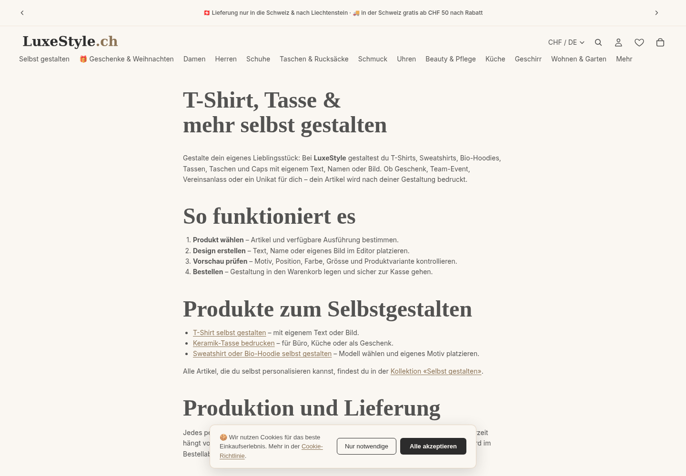
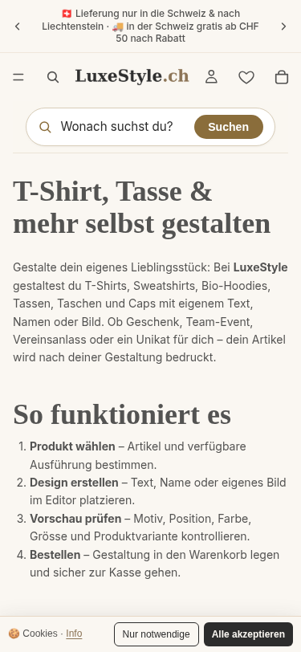
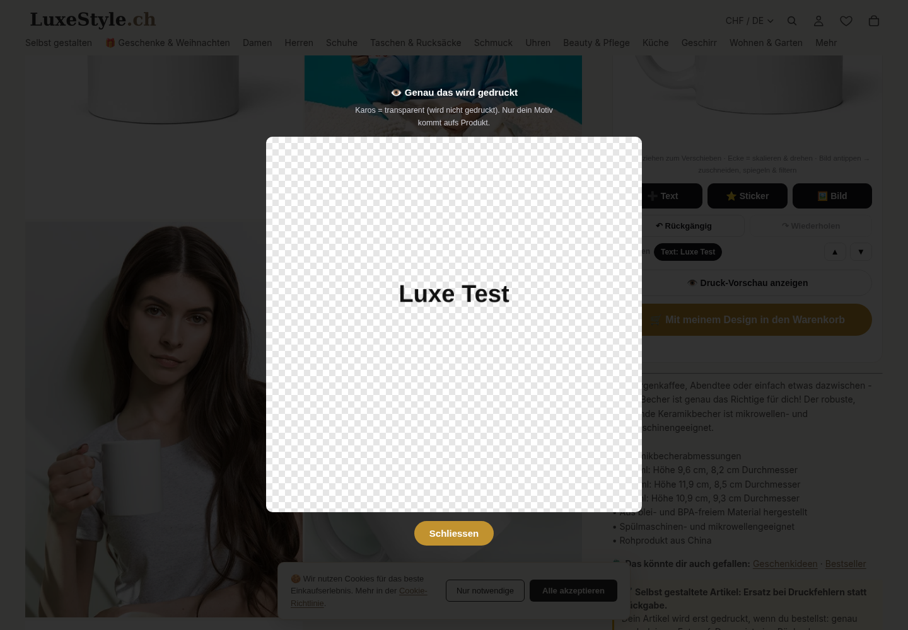
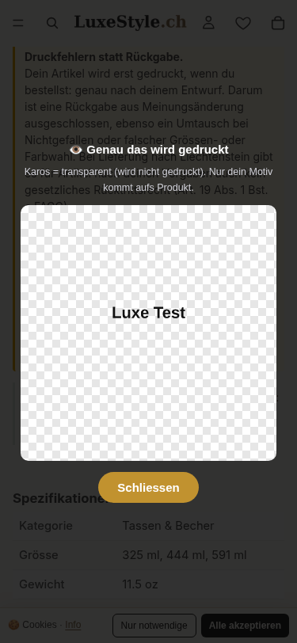
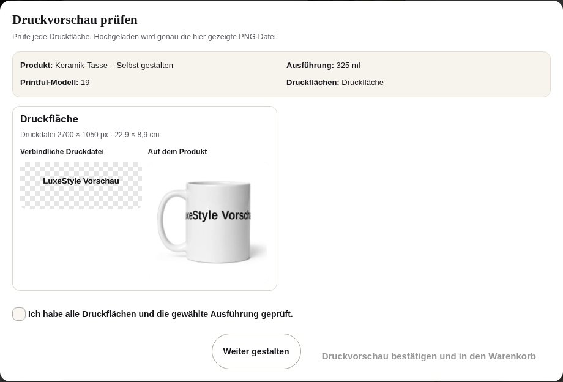
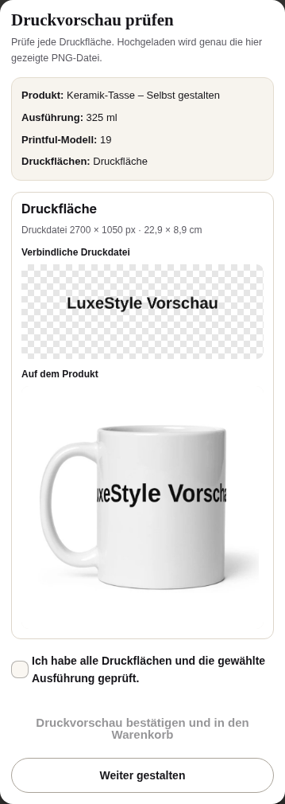
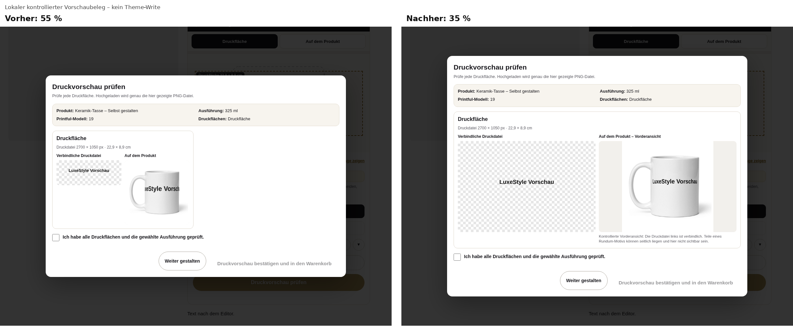
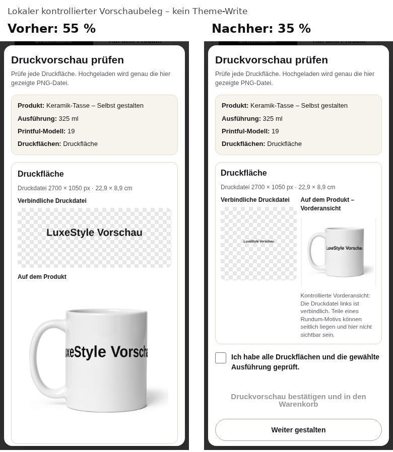
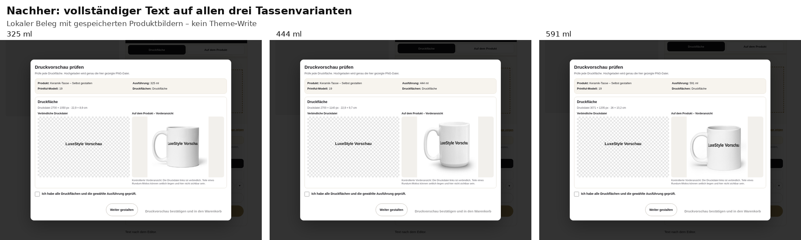

# LuxeStyle R136 – durchgängige Druckvorschau und Live-Gegenprobe

Stand: 08.11.2026, Europe/Zurich. Dieser Bericht setzt R135 fort. Er ist ein technischer Beleg für den unveröffentlichten Tassen-Pilot und keine Freigabe zur Theme-Publikation, physischen Produktion oder Katalogausweitung.

## Ergebnis

Der bisher getrennte v6.3-Nachweis wurde gegen die damalige Draft-Datei SHA `38e4b18e…` in genau einem reproduzierbaren Draft-Lauf vollständig verbunden: drei Tassenvarianten, Produktansicht, 300-dpi-Metadaten, harte Niedrigauflösungs-Sperre, Design- und Varianteninvalidierung, mobile Darstellung, Prüfdialog, bytegleiche Druckdatei, zwei erfolgreiche Cloudinary-Uploads, genau ein erfolgreicher Warenkorbzugang, POD-Property-Rücklesung und anschliessendes Leeren des Warenkorbs. Es gab keine Checkout- oder Bestellanfrage. Nach diesem Lauf wurde die vom Inhaber beanstandete Projektion korrigiert; der aktuelle Draft trägt SHA `9166bb8b…`. Der grüne Lauf ist deshalb ein belastbarer Vor-Korrektur-Beleg und keine Abnahme des aktuellen Draft-Assets.

Der Lauf fand ausschliesslich gegen das UNPUBLISHED Theme `213482963335` statt. MAIN `213013037447` wurde nicht geändert. Der zuvor beobachtete Kombiharness-Fehler war kein v6.3-Produktfehler: Der alte Test erzeugte einen künstlich inkonsistenten Radiozustand und versuchte einen gestreamten Multipart-Body über eine dafür unzuverlässige Chromium-Schnittstelle zu lesen. R136 startet den echten Netzweg in einem sauberen 325-ml-Zustand und erfasst den tatsächlichen Blob bei `FormData.append`.

## Dauerhafte Testbelege

- [Reproduzierbarer Harness](DRUCKVORSCHAU-E2E-20261108-R136.mjs), SHA-256 `32cf0c22ba16bf57d8b54953bfd9dce7f1c2bd0656bc9947a0ec720d1f984887`
- [Vollständiges Ergebnis](DRUCKVORSCHAU-E2E-20261108-R136-result.json), SHA-256 `79d5f53b0bc129ee6e9359253e80ea9d4f31819e9eb988d447606da187351900`
- Geprüfte Draft-URL: `https://luxestyle.ch/products/keramik-tasse-selbst-gestalten?preview_theme_id=213482963335&variant=55777979629953`
- Browsergrösse/Locale: 375×812, `de-CH`
- Abschluss: `2026-11-08T09:08:49.412Z`

Die im Prüfdialog geladene Druck-PNG und der tatsächlich an `FormData` übergebene PNG-Blob sind bytegleich: 87’216 Bytes, SHA-256 `09f4ac759df7e41d3933625932b55b0329115d443c60dad1002427e571aae3bb`. Die zusätzliche JPEG-Datei ist die Produktvorschau und wurde nicht mit der Druckdatei gleichgesetzt.

| Ausführung | Shopify-Variante | SKU | Printful-Variante | Druckdatei / Anzeige |
|---|---:|---|---:|---|
| 325 ml | `55777979629953` | `9365183_1320` | 1320 | 2700×1050 px, 22,9×8,9 cm, 300 dpi |
| 444 ml | `55777979662721` | `9365183_4830` | 4830 | 2700×1140 px, 22,9×9,7 cm, 300 dpi |
| 591 ml | `55777979695489` | `9365183_16586` | 16586 | 3071×1205 px, 26,0×10,2 cm, 300 dpi |

Der Editor blockierte ein Testbild mit rund 3 dpi. Vor Zustimmung wurden weder Upload noch Warenkorbzugang beobachtet. Nach Zustimmung: zwei Cloudinary-Antworten HTTP 200, genau ein `/cart/add.js` HTTP 200, Variante `55777979629953`, `_pod_karte` mit Modell 19/Printful 1320 und passende Druckdatei-/Vorschau-Properties. Danach `/cart/clear.js` HTTP 200 und Warenkorbanzahl 0. Es gab null Checkout-/Order-Requests und im finalen Clean-Lauf null Seitenfehler. Der frühere diagnostische Lauf hatte `showPopover on disconnected popover` durch das Entfernen der Shopify-Preview-Bar im Harness selbst ausgelöst; dies ist kein Theme- oder v6.3-Produktfehler.

## Printful-/Schweizer-Mass-Gegenprobe

Der bestehende Bestellweg liest die Printful-ID aus der SKU-Endung; alle drei heutigen Shopify-Varianten stimmen damit überein. Die Pilotkarte entspricht den am 05.11.2026 authentifiziert gelesenen Printful-Geometrien. Die metrischen Bezeichnungen entsprechen rechnerisch 11/15/20 US fl oz: 325,31/443,60/591,47 ml. Für mindestens 150 dpi braucht ein flächendeckendes Bild mindestens 1350×525, 1350×570 beziehungsweise rund 1536×603 px; der Editor exportiert in der jeweiligen 300-dpi-Zielgrösse.

Ein aktueller öffentlicher Produktzugriff war möglich; Printfile-/Template-Endpunkte antworteten ohne aktuelle Runtime-Credentials mit HTTP 401. Deshalb bleibt der authentifizierte Abruf vom 05.11.2026 die jüngste belastbare Geometriequelle. Die Produktansicht nutzt eine aus Katalogbildern kalibrierte Tassenprojektion und ist kein exakter Beleg für Naht-, Henkel- oder Druckposition. Eine physisch produzierte und vermessene Mustertasse sowie separat dokumentierte Bildrechte fehlen.

## Live-Gegenprobe des MAIN-Themes

`/pages/selbst-gestalten` antwortete HTTP 200, war selbstkanonisch, deutsch und bei 1440 sowie 375 px ohne horizontalen Überlauf oder Seiten-JavaScriptfehler. Die Tassenvarianten, CHF-Preise, Zentimeter- und Milliliterangaben sowie der deutsche Editor waren sichtbar. Ein lokaler Textentwurf und die bestehende Druckdatei-Vorschau funktionierten ohne Upload.

### Vorher/Nachher-Bildstrecke: Live-MAIN und unveröffentlichter Draft

Alle vier Bilder zeigen das aktuelle Live-MAIN `213013037447`, nicht den unveröffentlichten Draft. Die Druckvorschau-Bilder dokumentieren deshalb bewusst den heutigen Zustand ohne Pflichtbestätigung.

**Live-MAIN, Selbstgestalten-Seite, Desktop 1440×1000**

**Live-MAIN, Selbstgestalten-Seite, Mobil 375×812**

**Live-MAIN, aktuelle Druckvorschau ohne Pflichtbestätigung, Desktop 1440×1000**

**Live-MAIN, aktuelle Druckvorschau ohne Pflichtbestätigung, Mobil 375×812**

| Bild | SHA-256 |
|---|---|
| Selbstgestalten Desktop | `2c1f400ad5f67140ee16de5e4fe4d4918231be45ba5bb5810412aef72fec23a1` |
| Selbstgestalten Mobil | `199869a9f75f14d15d019528dbe3417b1d8893ddce01f8ebef6d17a20620e7e8` |
| Druckvorschau Desktop | `7c7c931b7c7ac8051d0047d2aa6a626723b46a1cd346a9a790c65565329761bb` |
| Druckvorschau Mobil | `db978e06000f2592e06bb11ba223b5eafae7a0021a212e2600093cda6be9a3a4` |

**Verworfene UNPUBLISHED-Zwischenversion, Desktop: Produktprojektion unproportional**

**Verworfene UNPUBLISHED-Zwischenversion, Mobil: Produktprojektion unproportional**

Diese beiden Bilder sind nicht live und ausdrücklich verworfen: Der Inhaber beurteilt die Produktansicht als unproportional. Sie sind nur ein Vorher-Beleg für die Korrektur und keine freigabefähige Nachher-Version. Der unveröffentlichte v6.3-Tassenpilot zeigte dabei Produkt-/Druckansicht, noch ungeprüfte Bestätigungscheckbox und gesperrten Bestätigungs-/Warenkorbweg. Während der Aufnahmen blieben Cloudinary, Cart-Add und Checkout/Order jeweils bei 0. Desktop-Panel 920×622 ohne inneren Überlauf; Mobil-Panel 359×1010 bei 359 px Breite. Der reine Screenshot-Harness löste beim Entfernen der Shopify-Preview-Bar je Ansicht einen `showPopover`-Fehler aus. Der finale Clean-E2E lässt die Bar bestehen und bestätigt `pageErrors=[]`; der Screenshotfehler ist kein Theme-/v6.3-Befund.

| Draft-Bild/Beleg | SHA-256 |
|---|---|
| Verworfene v6.3-Zwischenversion Desktop | `8d3e625dbc9ba1122b4885b73f7c5713eef6f25c6e273ddcff8b27d926bda946` |
| Verworfene v6.3-Zwischenversion Mobil | `18d9525dd4f004a8e0103acbcb9dd5c50c79fbcbc05a5589e4f204c0d0881f5b` |
| Verworfener Aufnahmebeleg JSON | `6716c6a9a21f0684590ba9acf7e8253c078d8599f30d3dbc22b1a1c492b25582` |

**Korrigierter lokaler Kandidat, noch weder Shopify-Draft noch live**

Der lokal entwickelte und danach eng in das UNPUBLISHED Theme geschriebene Kandidat verkleinert neue Tassen-Texte von Skalierung0,55 auf0,35. Bereits gespeicherte0,55-Entwürfe und Nicht-Tassen bleiben unverändert. Die Reviewansicht ist als kontrollierte Vorderansicht beschriftet; die Druckdatei links bleibt verbindlich, weil Teile eines Rundummotivs seitlich liegen können.12 Unit-,32 Editor- und76 Preview-Prüfungen sowie die lokale visuelle Drei-Varianten-Prüfung sind grün. Nach der lokalen Prüfung wurde genau dieses JS-Asset in das UNPUBLISHED Theme geschrieben und bytegenau zurückgelesen; die Bilder bleiben lokale kontrollierte Vergleiche und sind keine nach dem Write geladenen Shopify-Draft- oder Live-Bilder.

| Lokaler Kandidatenbeleg | SHA-256 |
|---|---|
| Kandidaten-JS | `9166bb8b9c4ae9f16b63b90ca3770cd6a0d3ad51602659c4b17e0e5f2a3a0991` |
| Vorher/Nachher Desktop | `411687fe3223fd77ef85a239e4abda26e542d4e3d85d1eb7a5658c55c20f18fb` |
| Vorher/Nachher Mobil | `289249f94486a1812004f698b6bfc4a49c820b3353e771ae4fef0dc6c8aa558b` |
| Alle drei Varianten | `94ef9aa34b87a7ae998a41037ed00322b3b847aa64753825f6ad23a6a14e977e` |
| Lokale Upload-Identität | `d6c7b48f8bcdb047f86d3501e3bb5aa9b9696aa48be74928051d0423d725d488` |

Die lokal simulierte Pipeline bestätigte je Variante bytegleiche Review-/Mock-Upload-PNGs:325ml 84’278B/`c0997993…`,444ml 89’127B/`220e06b2…`,591ml 104’362B/`85c8daa6…`; keine Browserfehler. Es erfolgte kein echter Upload, Warenkorbzugang, Checkout oder Auftrag.

**Enger UNPUBLISHED-Write:** Nach frischer Gegenprobe wurde genau `assets/lspod-designer-v6-6.3.0.js` im Theme213482963335 geschrieben: MD5 `403cbd9ff0883b0676daf209b33765e6`→`b6d3eac0e62208f216ef8dae3d1b0711`,225’915B, SHA-256 `9166bb8b…`, `userErrors=[]`, `processing=false/processingFailed=false`, `updatedAt=2026-11-08T09:37:48Z`. v5`abc4e9d6…` und Draft-Layout`fe3e85d7…` blieben unverändert. MAIN blieb v5`be85494…`/Layout`cf5ee5…`, v6.3 dort `NOT_FOUND`; kein Publish. [Write-/Readback-Beleg](DRUCKVORSCHAU-PROJEKTION-20261108-R136-theme-write.json), SHA-256 `e8f84f2f02949c8046a383faa19cad8bc108c7edfea949209b44c86e4b4b92ce`.

Ein begrenzter direkter Postwrite-Draft-Preview-Read und eine Page/CDN-Gegenprobe lieferten HTTP503. Eine spätere unabhängige mobile Firecrawl-Gegenprobe erreichte dieselbe Draft-URL mit HTTP200, zeigte die Shopify-Preview-Bar «Draft», die Druckvorschau-UI und für Variante `55777979629953` sichtbar `326 g` (Scrape-ID `01a1ba8f-33a7-76fe-b8e2-8a91622d04bd`; Feedback-ID `01a1ba8f-f6ab-70e4-aee2-7b722a2c7970`). Damit sind Draft-Erreichbarkeit und das erste metrische Gewicht nach dem Write bestätigt. Firecrawl konnte weder die nach Interaktion fertige Mockup-Version noch deren Proportion sicher bestimmen; ein direkter Screenshot-Download endete erneut HTTP503 und wurde nicht wiederholt. Die visuelle Shopify-Draft-Proportionsabnahme und der reale Clean-E2E für das neue Asset bleiben unbekannt. Der frühere vollständig grüne Clean-E2E bezieht sich auf die inzwischen ersetzte Draft-v6.3-Datei SHA`38e4b18e…` und darf nicht als Postwrite-Abnahme des aktuellen SHA`9166bb8b…` ausgegeben werden.

Die verbesserte R135/R136-Prüfung ist noch nicht live:

- MAIN lädt weiterhin die alte v5-Datei, SHA-256 `70140421381326aff999bd84094b9997eda3e9432037def69185d65ff003e808`; der Draft-Fix hat SHA-256 `0cc241059ef8dc9cfca6f2a162db8c32f99dc85c131e75aa7e4dbebeb8b28a47`.
- Die Live-Vorschau hat kein `role=dialog`, kein `aria-modal`, kein zugängliches Label und keine Bestätigungscheckbox. Sie zeigt nur die Druckdatei, keine Produkt-/Druckflächenansicht.
- Ein zweites altes CDN-Script `lspod-designer-v5.js` wird zusätzlich geladen. Ein Global-Guard verhindert aktuell die Doppelinitialisierung; der unnötige Download bleibt ein Risiko.
- `templates/product.json` rendert `v.weight | weight_with_unit: v.weight_unit`. Admin führt für 325/444/591 ml die Gewichte 11.5/16/18.9 oz. Live bleibt der Wert nach Variantenwechsel fälschlich bei `11.5 oz`; eine statische Ersetzung wäre ebenfalls falsch. Eine dynamische metrische Lösung ist nötig, wurde aber nicht geschrieben.
- `/fr/pages/selbst-gestalten` und `/fr/products/keramik-tasse-selbst-gestalten` deklarieren `lang=fr`, liefern aber deutschen Titel, H1 und Text. Die Translation-Listen für Page698444710273 und Produkt15422823465345 sind leer; Shopify zeigt deutsche Fallbacks. Die Sprach-/Duplicate-Lücke ist frisch bestätigt.
- Konkrete Lieferdaten, Mengenrabatte und `WELCOME10` wurden in diesem Lauf nicht belegt und deshalb nicht als verifiziert eingestuft.

Die Live-Gegenprobe führte keine Uploads, Warenkorbzugänge, Checkouts oder Bestellungen aus.

Separater, enger Header-Textdiff zur Freigabe: `Lieferung nur in die Schweiz & nach Liechtenstein` → `Versand in die Schweiz und nach Liechtenstein`. Ein geplanter enger Write wurde vor der Mutation korrekt abgebrochen: Der aktuelle Draft-Header MD5 `d6dc242e…` endet mit `ab CHF 50 Warenwert`, während MAIN MD5 `d62af614…` den zu erhaltenden Zusatz `nach Rabatt` enthält. Wegen dieser Baseline-Abweichung erfolgte kein Upsert. MAIN blieb unverändert. Dieser Copy-Diff gehört nicht zur Option-B-Theme-Allowlist; bei einer späteren Umsetzung ist eine frische MAIN-Basis mit exakt begrenztem Hunk nötig, niemals die Übernahme des ganzen Draft-Headers.

### Metrischer Gewichtskandidat, nur im UNPUBLISHED Theme angewendet

Ein enger Kandidat behebt die Variantenanzeige nur für `keramik-tasse-selbst-gestalten`: 325 ml→326 g, 444 ml→454 g, 591 ml→536 g und beim Rückwechsel wieder326 g. Andere Produkte behalten ihre bisherige Gewichtslogik. Der 375-px-Browsertest bestand ohne Seitenfehler, Uploads, Warenkorb-, Checkout- oder Bestellanfragen.

Danach wurde ausschliesslich `templates/product.json` im UNPUBLISHED Theme `213482963335` geschrieben. Der semantische Diff betrifft nur `sections.main.blocks.product-details.blocks.lux_spezifikationen.settings.custom_liquid` und enthält den exakten Handle-Guard. Readback: MD5 `6b44c4493538e99f42d2397ae330a828`→`2e72a6ad93d535435ecf224c9b68b1dc`, 71’420 B, `updatedAt=2026-11-08T09:42:26Z`, `userErrors=[]`. Das korrigierte v6.3-Asset MD5 `b6d3eac0…` blieb erhalten. MAIN behielt `templates/product.json` MD5 `6b44c449…` und weiterhin kein v6.3-Asset. Es gab keine Veröffentlichung und keinen Shopify-Produktobjekt-, Warenkorb-, Checkout- oder Bestellwrite. Die unabhängige Firecrawl-Gegenprobe bestätigte später die Draft-Seite und sichtbar `326 g`; die vollständige 326/454/536-g-Variantenfolge bleibt durch den lokalen Browsertest belegt, weil die interaktive Postwrite-Draft-Abnahme nicht vollständig lief. [Write-/Readback-Beleg](METRISCHES-GEWICHT-20261108-R136-theme-write.json), SHA-256 `9629044f45063dd6a5e21988cf013066941413820554b4eb9a6cfdd27236a936`.

- [Bericht](METRISCHES-GEWICHT-20261108-R136.md), SHA-256 `0282e69a468a4e8c11f907840d7c0d61b65c525e21ea2f851a6351aa1b1879c3`
- [Reviewbarer Patch](METRISCHES-GEWICHT-20261108-R136.patch), SHA-256 `cb760ce545209fc0489d36d19c40ee4f96e9de6c17b898dbb0045961800a1db5`
- [Maschinenbeleg](METRISCHES-GEWICHT-20261108-R136.json), SHA-256 `57ceb7c834bcff0ed664e6f93df17d837880948d1f7beab01580c7f14d498473`
- [Test](METRISCHES-GEWICHT-20261108-R136-test.mjs) und [Ergebnis](METRISCHES-GEWICHT-20261108-R136-test-result.json)

## PR- und CI-Gegenprobe

Draft-PR [#2944](https://github.com/allengchour-glitch/aban-news-landing/pull/2944), Head/Remote `ea877d4487c52eaf2290cd92dd988f61f14d1aa1`, bleibt mergeable, ungemergt und undeployed. Die gezielten Review-Gates wurden erneut mit 120 Prüfungen bestanden; `node --check` und `git diff --check` sind grün. Die relevanten GitHub-Prüfungen für Tests, Selbstgestalten, Lagerbestand, Voice und Pages sind grün. Es wurde kein PR-spezifischer Codefehler gefunden und kein Codepatch erzeugt.

Der rote Deploy-Check ist ein repo-weites Systemproblem: Er validiert 1’150 HTML-Dateien einzeln und wurde in den letzten 20 Läufen auf PRs und `main` jeweils am Acht-Minuten-Limit abgebrochen. Drei Workers-Fehler und ein externer Pages-Status treten auch bei benachbarten PRs ohne Annotationen auf. Kein Retry, Workflow-Dispatch, Merge oder Deployment.

## Freigabe-Diff

Der frische native Read zeigt weiterhin zwei getrennte Themes ohne Verarbeitungfehler:

| Datei | MAIN `213013037447` | UNPUBLISHED `213482963335` |
|---|---|---|
| `assets/lspod-designer-v5-safe.js` | 51’378 B, MD5 `be85494be069a484807b65ee32261a8a` | 63’950 B, MD5 `abc4e9d6dee7716e1bd3439d8280ebfb`, SHA-256 `0cc241059e…` |
| `layout/theme.liquid` | 61’986 B, MD5 `cf5ee5a64ca940edf4120b09c073e58f` | 62’235 B, MD5 `fe3e85d7da50eb8f0b8152350d1a79f1` |
| `templates/product.json` | 69’405 B, MD5 `6b44c4493538e99f42d2397ae330a828` | 71’420 B, MD5 `2e72a6ad93d535435ecf224c9b68b1dc`; separater Tassen-Gewichtsdiff, nicht Teil von Option B |
| `assets/lspod-designer-v6-6.3.0.js` | fehlt | 225’915 B, MD5 `b6d3eac0e62208f216ef8dae3d1b0711`, SHA-256 `9166bb8b…`; Postwrite-E2E/visuelle Draft-Abnahme wegen HTTP503 unbekannt |
| `assets/lspod-karte-19.json` | fehlt | 2’690 B, MD5 `f6aafc1cf13e9456cd78602ad02399b4`, SHA-256 `b8983106…` |
| `assets/lspod-vorschau-19.json` | fehlt | 1’410 B, MD5 `45f219ece6df8d8e93733d6adf191c05`, SHA-256 `8fbdaa58…` |

**Option A, kleinster Live-Schritt:** auf einer frischen MAIN-Kopie nur `assets/lspod-designer-v5-safe.js` ersetzen. Das bringt die allgemeine Pflichtvorschau, aber nicht den geprüften v6.3-Tassen-Pilot. Wegen der breiten Wirkung über alle v5-Produkte stützt sich diese Option bisher nur auf Hoodie-Smoke und T-Shirt-E2E und ist nicht die empfohlene Freigabeoption.

**Option B, Ziel-Allowlist nach erneuter Draft-Abnahme:** auf einer frischen MAIN-Kopie genau fünf Operationen: v5-Asset ersetzen, drei v6.3-Assets hinzufügen und ausschliesslich den geprüften Layout-Hunk mit 41 Einfügungen/1 Löschung anwenden. Der Hunk ist auf `product.handle == 'keramik-tasse-selbst-gestalten'` begrenzt. Die vollständige Draft-`layout/theme.liquid` darf nicht kopiert werden, weil bereits die Vor-v6-Draftfassung MD5 `4447d5…` von MAIN `cf5ee5…` abwich. Option B ist aktuell blockiert: Der korrigierte Kandidat SHA `9166bb8b…` wurde zwar als genau ein Asset im UNPUBLISHED Theme zurückgelesen und Firecrawl bestätigte später Draft-Seite, Vorschau-UI und `326 g`, aber nicht die interaktive Mockup-Version/Proportion oder den vollständigen Clean-E2E. Vor einem MAIN-Transfer müssen der aktuelle Draft interaktiv geladen, der vollständige Clean-E2E real erneut ausgeführt und neue proportionale Draft-Bilder abgenommen werden. Kein blinder Retry.

Ausgeschlossen bleiben alle anderen Theme-Dateien einschliesslich des separaten `templates/product.json`-Gewichtsdiffs, Produkttitel/-texte, FR-Inhalte, Rabatt-/Lieferclaims, Varianten, SKUs, Preise, Inventar, Checkout/Order sowie die Bereinigung des zusätzlichen Legacy-CDN-Scripts. Produkt15422823465345 war bei der Gegenprobe ACTIVE, `updatedAt=2026-11-08T04:58:27Z`; drei Varianten/SKUs unverändert.

Vor einer späteren Veröffentlichung sind aktuelle MAIN-Hashes, exakt diese Allowlist und der Postwrite-Readback Pflicht. Danach müssen drei Varianten, DPI-Sperre, Invalidierungen, Dialog/A11y, 375/1440 px, PNG-Bytegleichheit, null Warenkorbzugänge vor Zustimmung, genau ein Cart-Add samt Properties, Clear0 und keine Checkout-/Order-Anfrage erneut bestehen. Legacy-CDN, kalibrierte Projektion ohne physisches Mockup/Mustertasse und separat offene Bildrechte bleiben dokumentierte Risiken. Der finale Clean-Harness hat keine Seitenfehler.

Das UNPUBLISHED Theme bleibt unveröffentlicht. Der Diff ist eine prüfbare Ziel-Allowlist, aber noch keine Veröffentlichungsfreigabe. Für den vollständigen Tassenpilot fehlt nach der Projektionskorrektur die erneute Shopify-Draft-Abnahme.

## Grenzen und nächster Schritt

- Genau zwei bestätigte, getrennte Writes im UNPUBLISHED Theme ersetzten ausschliesslich das v6.3-JS-Asset und den handle-begrenzten Gewichtsdiff in `templates/product.json`. Kein MAIN-/Publish-, Layout-, v5-, Shopify-Produktobjekt-, Flow-, Metricool-, Merchant-, DNS-, Budget-, Rabatt-, Kunden-, Warenkorb-, Checkout- oder Bestellwrite.
- Heutige Metricool-Kennzahlen und Klaviyo-Berichte wurden nicht wiederholt.
- Eine Live-Publikation benötigt eine ausdrückliche, auf die freigegebene Dateiliste begrenzte Theme-Freigabe und frische Prewrite-/Postwrite-Gegenprobe.
- Physische Druckqualität, Farbtreue, Position und Bildrechte bleiben bis zu separatem Rechtebeleg beziehungsweise einer ausdrücklich genehmigten Mustertasse unbekannt.
