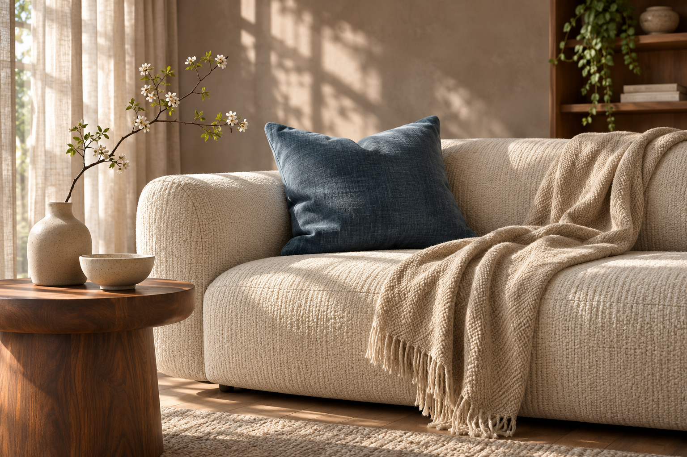
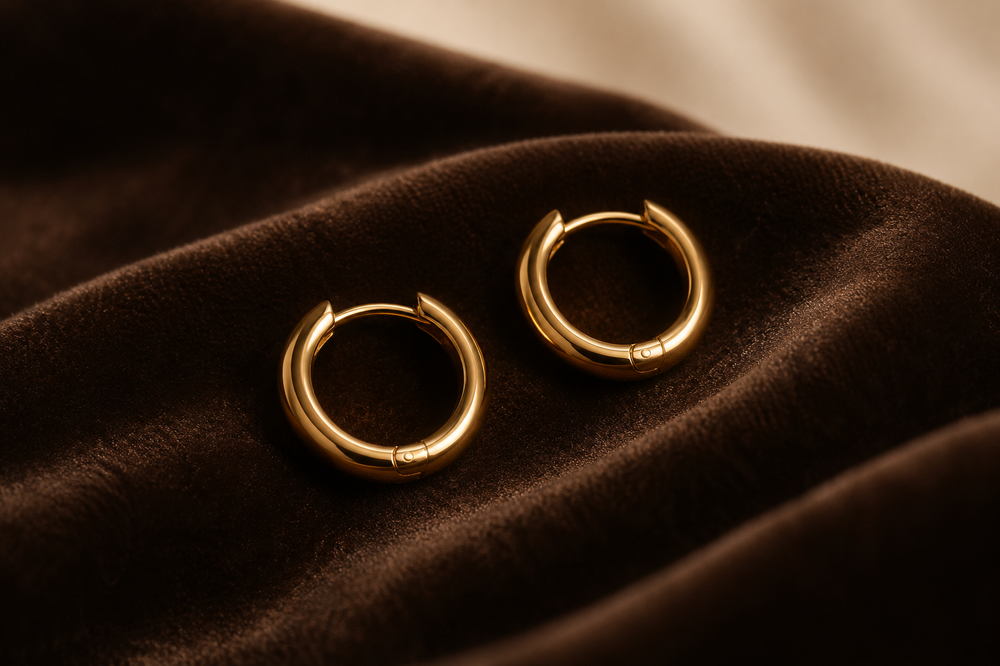
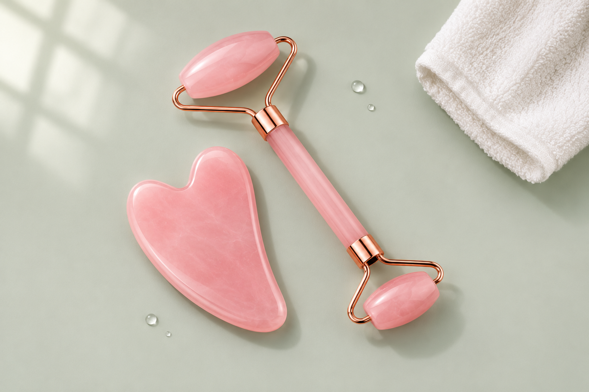
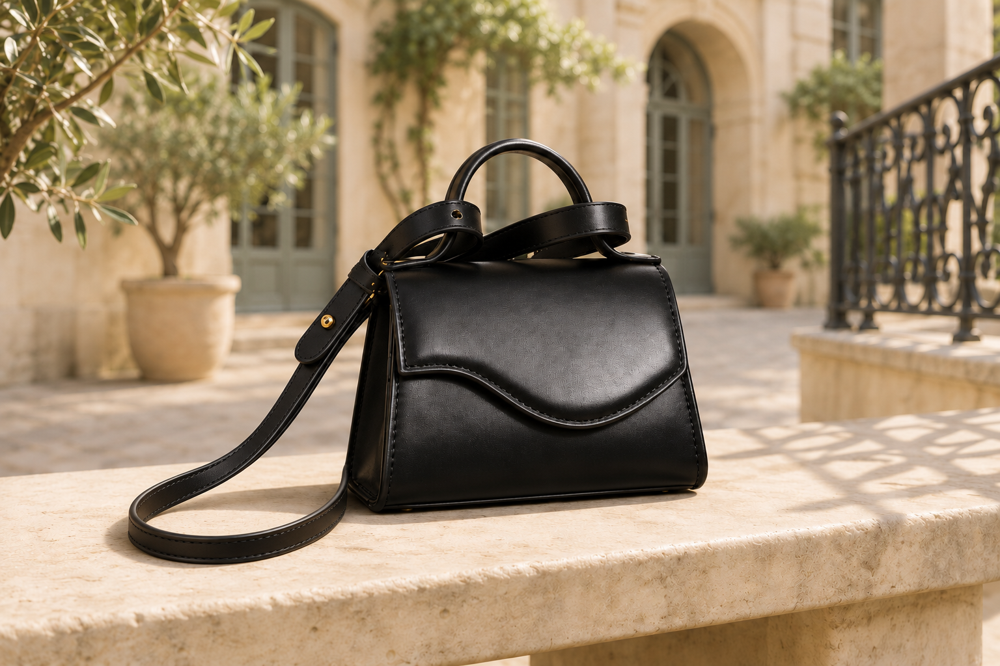

# LuxeStyle: vier zusätzliche Kategoriebilder – 04.11.2026, R74

Vier neue Bilder tatsächlich generiert und visuell geprüft, je 1536 × 1024 px (3:2). Das bestehende Banner und sämtliche Website-Dateien bleiben unverändert. Dies ist das ergänzende Bildpaket, noch keine Einbindung oder Veröffentlichung.

Die Motive sind illustrative Kategorieszenen. Sie belegen weder ein bestimmtes lieferbares Produkt noch Material, Masse oder Funktionen. Beauty und Taschen beziehen sich auf vorhandene Websitebilder; Proportionen und Details sind keine geprüfte SKU-Abbildung.

| Kategorie | Neues Motiv | Geplanter Einsatz |
|---|---|---|
| Wohnen | Helle Wohnszene mit blauem Akzent; Blickwinkel im Raum statt flacher Produktcollage. | Zusätzliche Inspiration für [wohnen-dekoration](https://luxestyle.ch/collections/wohnen-dekoration) |
| Schmuck | Dunkle Nahaufnahme mit klaren Lichtkanten; Kontrast zum übrigen hellen Bildsatz. | Zusätzliche Inspiration für [schmuck](https://luxestyle.ch/collections/schmuck) |
| Beauty | Grafische Draufsicht in Salbei und Rosa; anderer Hintergrund und Bildaufbau als die bisherige Szene. | Zusätzliche Inspiration für [beauty-pflege](https://luxestyle.ch/collections/beauty-pflege) |
| Taschen | Schwarze Tasche in heller Aussenaufnahme; Riemenfehler der ersten Fassung korrigiert. | Zusätzliche Inspiration für [sub-taschen](https://luxestyle.ch/collections/sub-taschen) |

## Wohnen: Licht und Texturen

[PNG herunterladen](luxestyle-kategorie-wohnen-20261104-r74.png) · 1536 × 1024 px · SHA-256 `015f1e843dfbcc3da12731898d1e22404818ecaff03398b5861ebd336d717c3d`

## Schmuck: Glanz im Detail

[PNG herunterladen](luxestyle-kategorie-schmuck-20261104-r74.png) · 1536 × 1024 px · SHA-256 `0208b48388acb5f914adf80dd230c19c3b75b74327df68d2b84cb7d5c7d2956f`

## Beauty: ein frischer Moment

[PNG herunterladen](luxestyle-kategorie-beauty-20261104-r74.png) · 1536 × 1024 px · SHA-256 `31a6456bb89849078f9544eef4eebeaeeabdafa942e0a97b99d767e3b4e3095d`

## Taschen: unterwegs im Tageslicht

[PNG herunterladen](luxestyle-kategorie-taschen-v2-20261104-r74.png) · 1536 × 1024 px · SHA-256 `0f03c032548c5049f359048c3e0e7c487da6fe20b372df6d3bbc063844e14e2b`

## Prüfung und Verwendung

- Vier unterschiedliche Bildaufbauten, keine eingebrannten Texte, Logos, Preise oder Bewertungen. Sichtprüfung durch Codex und eine unabhängige zweite Bildprüfung.
- Taschen-V1 wegen sichtbar losem Riemenende verworfen. Ausschliesslich V2 ist im finalen Paket; der Riemen läuft jetzt plausibel hinter der Tasche weiter.
- Für zusätzliche Karten bevorzugt 3:2. Ein Quadrat bei Beauty/Schmuck zentral; bei Wohnen auf Sofa/Kissen fokussieren, bei Taschen ungefähr `object-position:30% 50%`. Diese Vorgabe ersetzt keine Prüfung des tatsächlichen mobilen Layouts.
- Kategoriebezeichnungen und Links als echtes HTML neben/unter dem Bild, nicht in das Bild brennen. Keine automatische Rotation und keine neue schwere Vollbreiten-Sektion nur für diese Bilder.
- Das gewünschte bestehende Hero-/Kategorie-Banner erhalten. Keine globalen Collection-Bilder oder Produktbilder überschreiben. Vor Einbindung Kategorien und Sortimentskontext frisch prüfen; bei ungeklärten Fremdrechten Referenzbearbeitungen nicht automatisch publizieren.
- Keine Website-/Social-Publikation, kein Shopify-Medienupload, kein neuer Kennzahl-/Flowreport und keine Kauf-Watch-Abfrage in diesem Schritt. Aktuelle Shop-/Metricool-Identitäten stimmen mit LuxeStyle überein.

[Manifest mit Quellen, Hashes und Prüfgrenzen](KATEGORIEBILDER-20261104-R74.json). Claude-Empfang unbekannt; Ablage ist keine Empfangsquittung.
