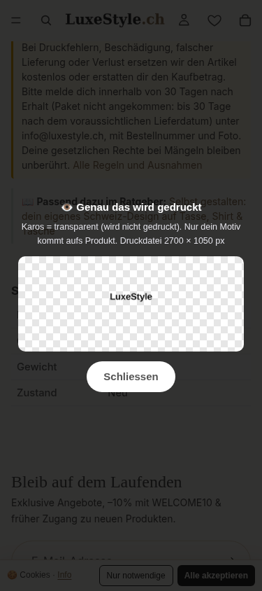
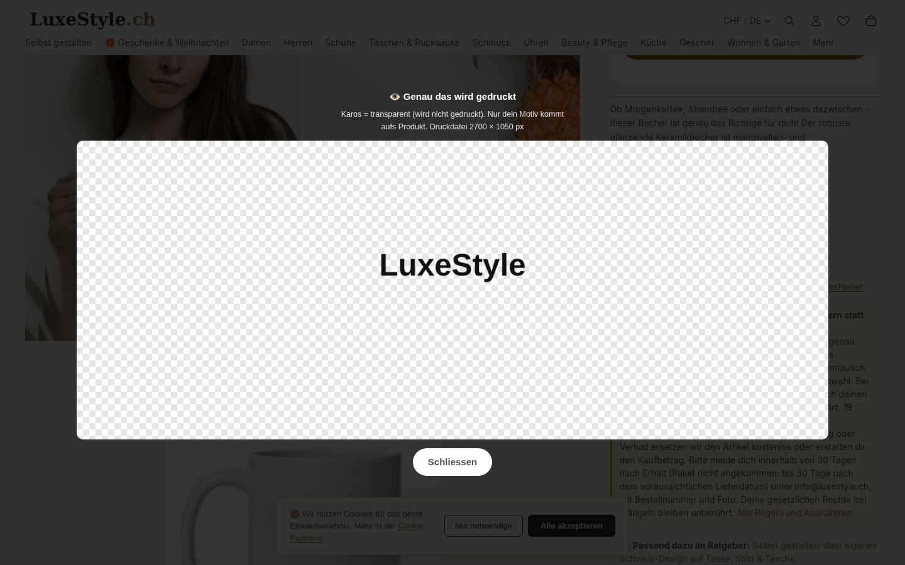

# Gestaltungseditor: Mobilprüfung und Fokuskorrektur – R237

Die öffentliche Keramik-Tasse wurde bei375,390 und1440 Pixeln geprüft. Der bisher offene Nachweis echter Viewportbreiten ist für diese drei Ansichten erbracht. Ein kleiner Tastaturfehler ist lokal korrigiert und als Reviewpatch gespeichert, noch nicht veröffentlicht.

| Prüfung |375×844|390×844|1440×900|
|---|---|---|---|
|Tatsächliche Browser-/Dokumentbreite|375/375|390/390|1440/1440|
|Editorbreite / Inhaltsbreite|343/343|358/358|429/429|
|Sprunglink: Fokus / Editorposition|lspod-start /99.8px|lspod-start /99.7px|lspod-start /100.3px|
|Text lokal bearbeiten und Produktvorschau öffnen|bestätigt|bestätigt|bestätigt|
|Druckvorschau: lokale Bildgrösse|2700×1050|2700×1050|2700×1050|
|Druckvorschau passt zur Fensterbreite|bestätigt|bestätigt|bestätigt|
|Fokus nach Escape in der Live-Fassung|BODY, Fehler|BODY, Fehler|BODY, Fehler|

Die ursprüngliche Sprunglink-Vermutung wurde durch die Funktionsprobe widerlegt. Kein Selektorpatch und keine unnötige Änderung vorgenommen. Die Textfelder sind ein Inline-Bearbeitungsbereich, kein eigener Textdialog. Bild-/Dateiupload, die Schaltfläche zum Warenkorb-Prüfablauf, Warenkorb, Checkout und Kauf blieben ausserhalb der Prüfung. Cookieauswahl nicht betätigt. Nicht-GET/HEAD-/Telemetrie-/Cart-Anfragen wurden im Runner blockiert; daraus resultierende Fremd-Pixelfehler sind keine bewiesenen Editorfehler. Der lokale Testtext «LuxeStyle» blieb im verworfenen Browserkontext; kein Druckauftrag und kein Social-Master.

## Kleiner Reviewpatch

Der vorhandene Printpreview-Schliesshandler entfernt das Dialogelement und gibt die Blob-URL frei. Anschliessend liegt der Fokus aufBODY. Der Patch ergänzt ausschliesslich `ui.preview.focus({ preventScroll: true })` mit kompatiblem Fallback im selben Handler. Kein weiterer Editor-/Preis-/Warenkorbcode geändert. Patch-SHA256:a0709e926ab8b9a291fed4db6d5e4d3a20b8f20f35e01a97001638ea57d79fd4; Kandidat-SHA256:ef2b639bf19f1b19118f3e1fa6d752b529b152ca187d69663c5bc84d92f488d7.

Eine lokale Browserfixture lieferte nur im Testprozess die Kandidatdatei samt neu berechnetem SRI aus. Bei390×844 kehrte der Fokus sowohl nach Escape als auch nach «Schliessen» korrekt zur Vorschau-Schaltfläche zurück; der Dialog war entfernt und die2700×1050-Vorschau unverändert. Diese Fixture ist ausdrücklich keine Live-Auslieferung. Vor einer produktiven Übernahme neuen versionierten Release, passende SRI/Referenzen und begrenzten Canary-/Rückweg prüfen; die eingebundene immutable6.4.0 nicht still überschreiben. Keine Workflow-Ausführung oder Deployment erfolgt; Safari/iOS, echter Handy-Browser/Softwaretastatur, Focus-Trap und übrige15 Editorprodukte nicht neu abgenommen.

## Quellen und Screenshots

Aktueller main-Commit:b172645eae849c33b09c5e98a05e6cb5db3c0e6a; Commit-Tree:ba783e1d8b53d9f318a7908a1f3301367c195923. Quellfile`pod/v6/lspod-designer-v6-6.4.0.js`, Gitblob1296cc6d7cb8fc69ed317db73d8ae26ecd10b227, SHA256e7e30bc231e6817f70e2cbd8089f57c82ad5ea7c285585709223798c16adb930. Hash/SRI und beide Tassenmaps passen zur öffentlichen Einbindung. Aktueller Produkt-/Variantenread ist ACTIVE,325ml/22.90CHF, tracked/CONTINUE; keine Bestands- oder Lieferzeitgarantie. Native und öffentliche Themeidentität:MAIN213991391623. Das freigegebene Theme214040805767 ist unveröffentlicht und wurde nicht geändert.

[Strukturierte Belege](PERSONALIZER-MOBIL-FOKUS-20261115-R237.json) · [Reviewpatch](PERSONALIZER-FOKUS-REVIEW-20261115-R237.patch). Die Rohnetzwerkdaten und Gastseiten-HTML bleiben lokal und werden nicht ins gemeinsame Repository kopiert. Kein neuer Merchant-Scan, keine Kennzahl-/Klaviyo-/Bestellreport-Wiederholung, keine zusätzliche Automation oder Kundenansprache. Claude-Empfang unbekannt.
