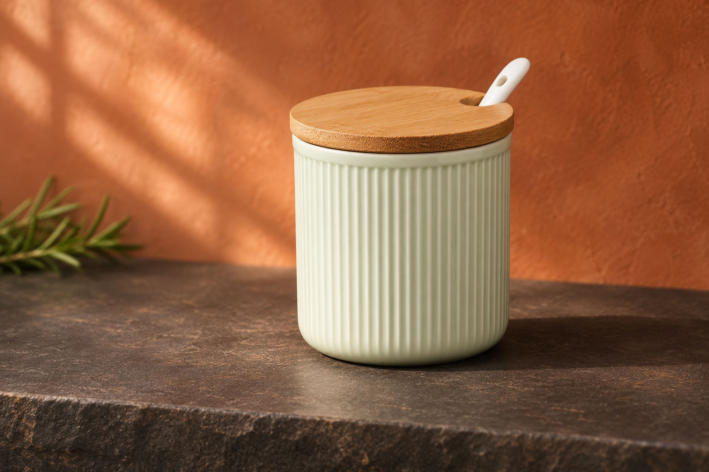
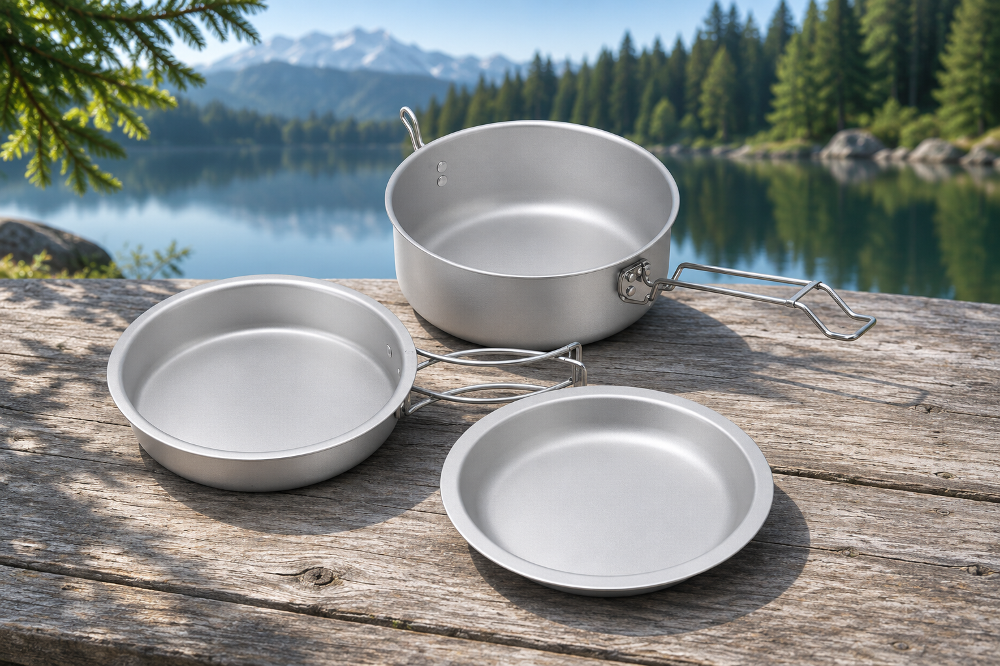
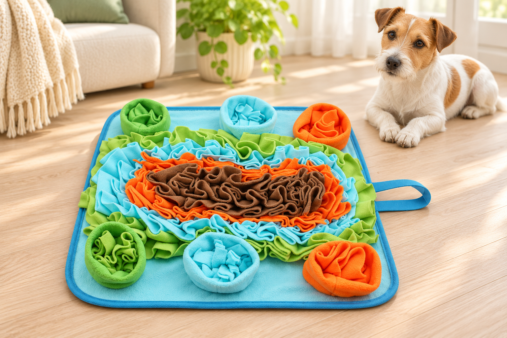

# LuxeStyle: neue Bilder mit anderen Shop-Produkten – 04.11.2026, R75

Drei neue Lifestyle-Entwürfe tatsächlich gerendert und gegen aktuelle Shopbilder visuell geprüft. Auf den neuesten Inhaberwunsch ist die Videoidee zurückgestellt. Die Produkte wurden nicht neu angelegt; es sind andere bestehende Artikel aus dem Shop. Bestehende Banner, R74-Bilder und Original-Produktfotos bleiben erhalten.

| Motiv | Bildwelt | Produktbezug |
|---|---|---|
| Keramik-Gewürztopf | Terrakotta und Salbeigrün | [Grün / B](https://luxestyle.ch/products/keramik-gewurztopf-im-nordic-style-492928?variant=67789402210695) – aktuell CHF 20.90 |
| Camping-Kochset | Klares Seelicht und Waldgrün | [Default Title](https://luxestyle.ch/products/camping-kochset-3-teilig-leicht-639500?variant=67760472424839) – aktuell CHF 21.90 |
| Hundematte | Fröhliche Farben im hellen Wohnraum | [Default Title](https://luxestyle.ch/products/hundennasenmatte-aus-fleece-energie-intelligen-622000?variant=67747895443847) – aktuell CHF 17.90 |

## Keramik-Gewürztopf

[PNG herunterladen](luxestyle-gewuerztopf-20261104-r75.png) · 1536 × 1024 px · SHA-256 `35595cbd843e8934aea76c2861e1c3cbba2c454ead04fb784e5f9b882bd82601`

## Camping-Kochset

[PNG herunterladen](luxestyle-camping-20261104-r75.png) · 1536 × 1024 px · SHA-256 `399b1441276d028a66732e46d9ca63de0a930a8dacb13a383f4d17b8c165484c`

## Hundematte

[PNG herunterladen](luxestyle-hundematte-20261104-r75.png) · 1536 × 1024 px · SHA-256 `836eea7b22ece69c0a2bafefa8b39abc482047570b50491c8251de065f81ae3b`

## Prüfung und Einsatz

- Aktive Produkte, nicht leere aktuelle Tags ohne Treffer des frisch gelesenen Kanalwächters; zusätzlicher rueckhol-Check ebenfalls ohne Treffer. Storefront-IDs und verfügbare Varianten bestätigt. Das sind keine Lieferzeit-/Lagerzusagen.
- Kleine gezielte Auswahl: drei Suchabfragen mit je vier Ergebnissen, keine Pagination; vier Produkte detailliert gelesen. Unpassende Tassel-Treffer nicht verwendet.
- Codex und unabhängige Zweitsicht prüfen Form, Farbe, Teilezahl und sichtbare Grafikfehler. Camping-Set, Hundematte und einzelner Gewürztopf sind als Lifestyle-Entwürfe brauchbar. Einzelne Falten, Proportionen und Lichtfarben sind keine vollständige SKU-Abnahme.
- Kaffeebereiter-Fassung bewusst ausgeschlossen: veränderte feine Marken-/Skalenbeschriftung. Nicht als Produktbild verwenden.
- Gewürztopf: Originalfoto zeigt drei Gefässe, Angebotstext nennt ein Stück. Das neue Motiv zeigt deshalb nur einen Topf. Variante Grün/B ist aktuell mit dieser Referenz verknüpft; exakte reale Grösse wird nicht aus der Szene abgeleitet.
- Die Bilder eignen sich als zusätzliche visuelle Vorschläge für Küche, Camping und Hundewelt. Kein Austausch des bisherigen Banners oder der Original-Produktfotos. Keine direkte Produktgalerie-/Socialfreigabe daraus ableiten.
- Noch kein Shopify-Upload und keine Website-Einbindung. Kommerzielle Drittanbieterrechte der Referenzen, genaue Farb-/Variantenabnahme und tatsächlicher mobiler Ausschnitt bleiben vor Veröffentlichung zu prüfen. Tracking/inventoryPolicy wurden für diese reine Bildvorbereitung nicht zusätzlich abgefragt.

[Manifest und Quellen](PRODUKTBILDER-20261104-R75.json) · [Finale drei Bilder als ZIP](PRODUKTBILDER-20261104-R75.zip). GitHub-Ablage ist keine belegte Kenntnisnahme durch Claude.
