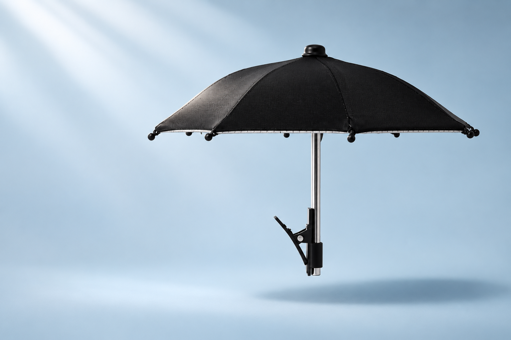
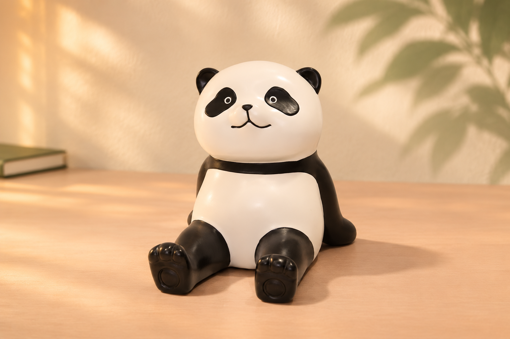

# LuxeStyle – zwei neue Produktmotive und begrenzte Weiterarbeit

04.11.2026, R78, Europe/Zurich. Zwei neue Bilder mit anderen aktuellen Shopprodukten sind tatsächlich erstellt und unabhängig visuell geprüft. Es sind **referenzbasierte, inszenierte Bildentwürfe**, keine Originalproduktaufnahmen. Beide sind lokal fertig; Website und Social-Kanäle wurden damit nicht verändert.

## Mini-Schirm: kühles Studio-Stillleben

[Schwarze Variante ansehen](https://luxestyle.ch/products/regenschirm-mit-handy-halterung-freihandig-8-streben-uv-beschichtet?variant=67788980650375) · aktuell CHF 16.90.

Der vollständige schwarze Schirm samt Schaft und Klemme folgt der eindeutig gebundenen Variantenreferenz. Die unabhängige Sichtprüfung findet keinen zwingenden Formfehler; ausgearbeitete Stoffstruktur und Lichtreflexe sind gestalterisch verändert. **Das Motiv steht rechts: 3:2 beibehalten oder vollständig mit `contain` darstellen. Ein mittiger Quadrat-/Hochkant-Crop würde Teile abschneiden.** Keine Klemmfunktion wird vorgeführt.

## Panda-Handyhalter: warmer Schreibtisch

[Variante «Niedlicher Panda» ansehen](https://luxestyle.ch/products/panda-handyhalter-susser-schreibtisch-stander-fur-smartphones?variant=67788961939847) · aktuell CHF 14.90.

Gesicht, Ohren, Arme, Bauch, Füsse und Sitzhaltung wurden gegen das ausdrücklich zugeordnete Originalbild geprüft. Der Entwurf ist visuell plausibel; Linien, Weisswirkung und Glanz sind leicht stilisiert. Die zentrale Position eignet sich grundsätzlich für Karten. Der tatsächliche Desktop-/Mobil-Ausschnitt bleibt vor Einbindung zu prüfen. Ohne Telefon entsteht keine erfundene Haltehandlung.

Beide Dateien haben 1536 × 1024 px. Produkt- und Variantenstatus wurden aktuell nativ und öffentlich gegengeprüft: ACTIVE, verfügbar, `inventoryPolicy=CONTINUE`, `tracked=false`. Daraus folgen keine Lager- oder Lieferzeitzusagen. Die Bilder ersetzen weder bestehende Banner noch Produktfotos. Exakte Fertigungstreue, kreative Inhaberabnahme und eigenständige kommerzielle Referenzrechte bleiben offen. Der Panda trägt ältere Social-Marker; diese neuen Bilder erlauben keine Wiederholung ohne Ledger-Prüfung.

Die Schmuckschale wurde wegen unklarer Formzuordnung zurückgestellt. Eine Retro-Tischuhr wurde wegen abweichender Bild-/Textmerkmale ausgeschlossen. Für beide wurde kein neues Bild erzeugt.

## Kategorieprüfung und nächster kleiner Fix

Taschen und Beauty wurden auf MAIN 213013037447 in Deutsch/Französisch bei 390 und 1440 px geprüft: acht Ansichten, 132 ausgewertete Bedingungen bestanden. Vier mobile Verfügbarkeits-Auswahlen blieben wegen Test-Timeout unbekannt; daraus folgt kein belegter Shopdefekt. Banner, Unterkategorielinks, Sprachpfade und Tastaturbedienung blieben im geprüften Umfang erhalten.

Eine gezielte Gegenprobe mit `beauty-pflege?filter.v.price.lte=50` belegt einen konkreten Fehler: Alle 15 Links des zusätzlichen SEO-Pagers enthalten nur `?page=N` und verlieren die aktive Preisgrenze. Nachweis sind DOM und Roh-HTML; der Screenshot zeigt den Pager nicht. Enger nächster Korrekturscope: diesen zusätzlichen Pager auch bei aktiven Mindest-/Höchstpreisgrenzen zurückhalten. Normale Shopify-Pagination, übrige Filter und Gestaltung erhalten. **Noch kein Patch angewendet und kein Theme geändert.**

Der Bericht zählt 13 explizite Seitennavigationen einschliesslich zweier unbeabsichtigter Wiederholungen durch einen danach lokal korrigierten Import. 28 Section-/Suchvorschlags-GET-Antworten sind für die acht Ansichten dokumentiert; die vollständige Subresource-Zahl ist unbekannt. Kein manueller Katalogscan und keine vollständige Websiteabnahme.

## Zwei vorhandene externe Videos geprüft

Duftbefeuchter (Metricool 416114579) und Gemüsehobel (416122901) zeigen in 41 Kontaktframes bewegte Produktdarstellung. Sie sind in dieser Stichprobe keine reinen Foto-Zoom-Abfolgen, dauern aber nur 10,68 beziehungsweise 10,16 Sekunden bei 25 fps. Damit erfüllen sie die vorgegebene Masterlänge und 30 fps nicht. Beim Hobel sind Hand und Kurbel teilweise abgeschnitten.

Ein kalibrierter Audiovergleich belegt keine direkte Zuordnung zu einem unverändert schnellen und gestimmten Ausschnitt der Pflicht-WAV. Mischen oder Zeit-/Tonhöhenänderungen sind damit nicht ausgeschlossen; alternative Quelle, Sprache und Rechte bleiben unbekannt. Keine vollständige Film-/Hör-/Plattformabnahme und kein Ersatz für denselben offenen Projektor-Master. Termine und PENDING-Angaben stammen aus R77; R78 hat die zugehörigen Dateien geprüft, keine Postzustände neu gelesen und keine Termine geändert.

## Übergabe

Die zwei neuen Bildentwürfe auf tatsächlichen Desktop-/Mobilkarten mit eindeutiger Variantenbindung und geklärten Bearbeitungs-/Werberechten prüfen. Beim rechtslastigen Mini-Schirm 3:2 erhalten oder contain verwenden; vorhandene Banner und R76-Karten nicht ersetzen. Kein pauschaler Produktfoto-Ersatz. Anschliessend den bestätigten Verlust der Preisgrenze im zusätzlichen SEO-Pager mit einem frischen minimalen Diff vorbereiten, normale Shopify-Pagination erhalten. Vor Änderungen an den zwei externen Videos genaue Produkt-/Variantenbindung und Film-/Musikrechte belegen; bestehende Termine und UUIDs erhalten. Heutige Kennzahl-/Flowreports und beendeten Kauf-Watch nicht erneut abfragen.

[Strukturierte Belege, Bild-QA, Quellenhashes und Teilberichte](WEITERARBEIT-BELEGE-20261104-R78.json) sind beigefügt. Nur dieses Dokument, die Beleg-JSON und die zwei erzeugten PNGs gehören zum GitHub-Paket. Originalreferenzen und diagnostische MP4s bleiben lokale Prüfdateien. R77-Tagesberichte und Tagespolicy bleiben exakt erhalten; Kauf-Watch ist beendet. Keine neuen Kennzahlen-/Flowreports, Shop-/Theme-/Socialwrites, Kundenansprache oder Automation. Claude-Kenntnisnahme ist unbekannt.
