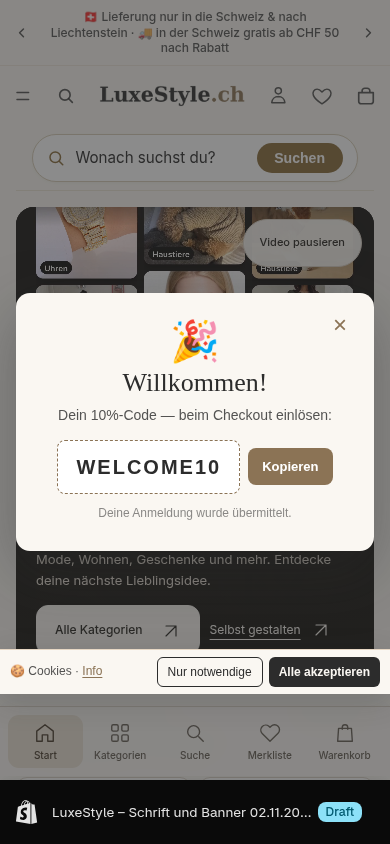

# R229 – Popup-Satz im Prüftheme gespeichert und Quellen geklärt

Die Rückmeldung lautet im unveröffentlichten Theme jetzt «Deine Anmeldung wurde übermittelt.» Die bisherige Sofort-E-Mail-Zusage wurde dort durch genau diesen Satz ersetzt. Aktuelle Footerdatei und Diff sind hashgebunden; Skripte, Listenziel, Formdaten, Consent, Rabatttext und Popup-Zeiten wurden nicht verändert.

Gespeichert wurde ausschliesslich sections/footer-group.json in «LuxeStyle – Schrift und Banner 02.11.2026» (213013037447). Save-Version14499e471299d707a12fb1d1986ac1390480a777; pending leer. Das Theme bleibt unveröffentlicht. Der Live-Stand213991391623 und sein Footerhash blieben erhalten. Eine spätere Live-Übernahme muss auf diesen Satz begrenzt werden; das gesamte ältere Prüftheme ist nicht für eine Veröffentlichung abgenommen.

Die native Theme-Aufnahme stellte Header/Symbole auffällig dar. Der MAIN-Desktop lieferte exakt dieselben Bildbytes wie das Prüftheme. Die unabhängige Gegenprobe im normalen Chromium zeigte dagegen den korrekt formatierten Header, Herz22×22px, keine fehlgeschlagenen Stylesheets und keinen horizontalen Überlauf bei1440/390. Daraus folgt keine globale Shop-Abnahme, aber auch kein belegter neuer CSS-Defekt durch diese Ein-Satz-Korrektur.

Nach dem Save wurde die mobile Preview einmal frisch geladen: HTTP200, neuer Satz im gelieferten DOM und alte Zusage in den geprüften Bestätigungsabsätzen nicht vorhanden. Für das Lesbarkeitsbild wurden nur die drei display-Stile des vorhandenen Popups gesetzt. Es gab keine Text-Injektion, Anmeldung, Submit-/done()-Aktion, lokale Zustands-/Consentänderung oder Kundenansprache. Das Bild zeigt einen Prüfzustand, keine echte Anmeldung. Laufzeit, Listeneintrag, Coupon-Gültigkeit und E-Mail-Zustellung sind damit weiterhin nicht getestet.

Die Musikprüfung benennt jetzt den konkreten nächsten Beleg: tatsächlich verwendete FluidR3_GM.sf2 bzw. SF2-Auswahl samt Hash und passender Copyright-/Lizenzdatei, verbunden mit dem vorhandenen WAV-Export. Producer und MIDI-Builder belegen den prozeduralen Kompositions-/Syntheseweg. Es wurde keine vollständige kommerzielle Rechtefreigabe oder Hörabnahme daraus abgeleitet. Der professionelle Projektor-Master bleibt ohne neue MP4; kein Alternativtrack oder Altclip wurde eingesetzt.

## Tagesergänzung

| Bereich | Was Codex gemacht hat | Ergebnis / Status |
|---|---|---|
| Fortsetzung / Identität | Aktuelle Core4 und heutigen Tagesblock gelesen; Shop, MAIN und Metricool-Marke samt sechs Kanälen frisch gegengeprüft | Revision228 fortgesetzt. LuxeStyle/luxestyle.ch/CHF/EuropeZurich und Marke6227837 passen. Andere Marken nicht bearbeitet; heutige R228-Reports und R226-GSC unverändert wiederverwendet. |
| Popup / Quelldiff | Aktuelle sections/footer-group.json vollständig gesichert und mit der gleichen Datei des neuesten unveröffentlichten Themes verglichen | Beide vor Änderung SHA59f8477f…37100. Genau ein Satz in /sections/custom_liquid_lxpopup/settings/custom_liquid geändert. Strukturdiff, wörtlicher Rückvergleich und Peerreview bestätigen: alle anderen Bytes und die gesamten Skripte erhalten. |
| Unveröffentlicht gespeichert | Nach frischer Gegenprobe genau eine pending Datei im Theme213013037447 gespeichert und erneut gelesen | Theme-Version14499e471299d707a12fb1d1986ac1390480a777; saved nur footer-group.json, pending leer, keine PushErrors. Nachher SHA9321568a…3f978 bestätigt. Theme bleibt UNPUBLISHED; MAIN213991391623 bleibt unverändert MAIN. Kein Live-Publish oder Produkt-/Flowwrite. |
| Darstellung / Gegenprobe | Native Screenshots für1440/390 und MAIN-Desktop aufgenommen; auffällige Headerdarstellung durch öffentlichen Chromium-Browser gegengeprüft | Native MAIN-/Preview-Desktopbilder byteidentisch, daher kein neuer Text-Diff-Effekt. In Chromium normaler Header, Herz22×22px, keine CSS-Fehler und kein horizontaler Überlauf bei1440/390. Native Bilder sind keine bestandene visuelle Abnahme. |
| Mobile Textabnahme | Nach dem Save genau eine frische mobile Preview geladen und gespeicherten Satz im DOM geprüft; nur Popup-display-Stile für Lesbarkeitsbild gesetzt | HTTP200; neuer Satz vorhanden, alte E-Mail-Zusage in geprüften Absätzen weg. Keine Text-Injektion, Anmeldung, done()-Aufruf, localStorage-/Consentänderung oder Kundensendung. Alle non-GET/HEAD-Anfragen blockiert. Insgesamt fünf Browserladungen; eine zusätzliche SVG-Prüfung überschritt das ursprüngliche Dreierlimit, die fünfte war die begründete Save-Nachprüfung. |
| Musik / Master | Aktuellen Producer und seinen ausdrücklich aufgerufenen MIDI-Builder quellengebunden gelesen | Prozedurale Komposition und Syntheseweg belegt. Tatsächlich verwendete SoundFont samt Hash/Lizenzbeleg fehlt im Prüfkontext; keine Rechte-/Hörabnahme abgeleitet. Drei GitHub-Reads, keine Binary-Neuladung, Installation, Generierung oder Render. Derselbe offene Master bleibt bestehen. |
| Fehler / Memory | Fehlversuch mit fehlendem python im Theme-Sandbox und den nativen Renderer-Befund dokumentiert; Quellen danach mit verfügbaren Shellwerkzeugen gesichert | Kein Auth-/Quota-Fehler oder leere-Daten-Beweis. Native Darstellungsauffälligkeit nicht als Live-Shopdefekt ausgegeben. Tagesblock,24IDs und Historien erhalten. Keine neuen Tagesreports, Socialposts, Löschungen, Budgets, Rabatte, Versand-/Flow-/DNSänderungen, Workflows oder Automation. Claude-Empfang unbekannt. |

## Nachweise

- [Popup-Diff und vollständige Gegenproben](POPUP-PRUEFSTAND-20261115-R229.json) · [Ein-Satz-Patch](POPUP-EINZELSATZ-20261115-R229.patch)
- [Browser-Desktop-Gegenprobe](BROWSER-DESKTOP-GEGENPROBE-20261115-R229.png) · [native Aufnahme mit begrenzter Aussagekraft](NATIVE-VORSCHAU-GRENZE-20261115-R229.webp)
- [Musikquellen](MUSIK-QUELLENPRUEFUNG-20261115-R229.md) · [gehashte Quellen und offener Nachweis](MUSIK-QUELLENPRUEFUNG-20261115-R229.json)
- [Laufbeleg](WEITERARBEIT-20261115-R229.json)

Heutige Kennzahlen/Klaviyo ausR228 und GSC ausR226 wurden nicht erneut abgefragt. Zeitplan, andere Freigabegrenzen und24stabile Aufgaben-IDs bleiben erhalten. Ein gespeichertes Prüftheme ist keine Live-Übernahme; Claude-Kenntnisnahme bleibt unbekannt.
