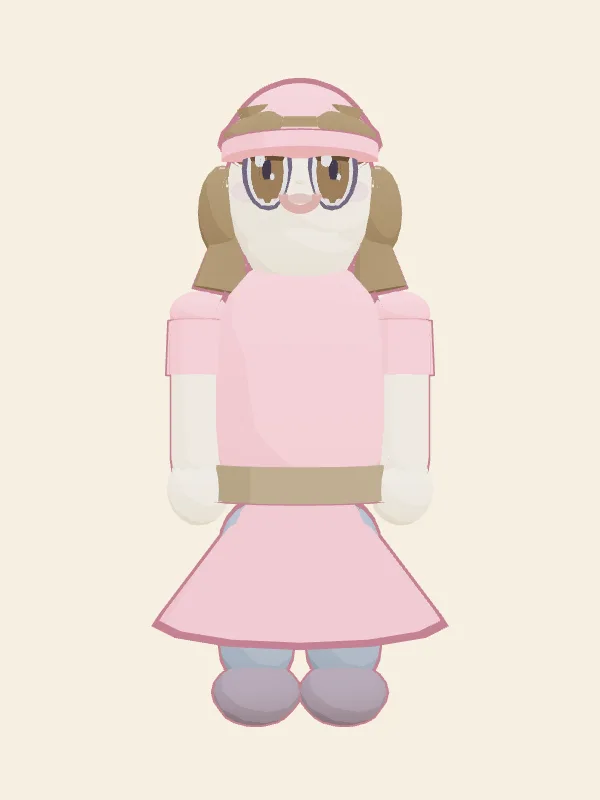
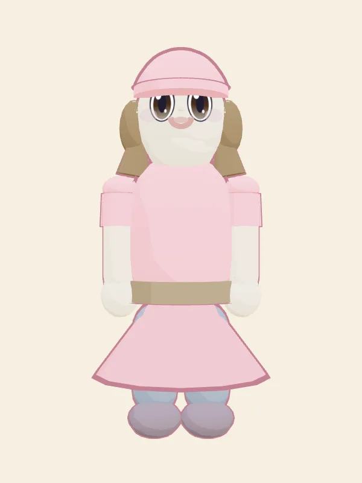

# Lebenspfad: Charakter überarbeitet ·16.11.2026

Auf Besitzerauftrag «kannst du charakter anpassen?» ist die vorhandene Comic-Figur gezielt verfeinert. Kopfbewegungen drehen jetzt Gesicht, Haare und Kopfbedeckung gemeinsam. Gewölbte Augenflächen mit gezeichneter Iris ersetzen sieben übereinanderliegende Kugeln je Auge; Glanzlichter und Blinzeln bleiben erhalten. Kappen und Mützen erhalten keine durchdringenden Stirnfransen, ein Bob keine zusätzlichen langen Seitensträhnen, ein Dutt passt unter die Kopfbedeckung. Das Streifenshirt verwendet die vorhandene Rumpffläche statt vier großer Kapselhüllen.

Die Vorschau passt die Kamera an die tatsächlichen Figurengrenzen an, einschließlich Schuhen, Hut und Krone. Ihr RenderTarget verwendet dieselbe sRGB-Ausgabe wie das Spiel; der vorhandene Haupt-Renderer wird weiterverwendet. Bestehende Figurenauswahl, gespeicherte Frisur-/Farbkonfigurationen, Meshy-Figuren und Online-Konfigurationen bleiben nutzbar. Keine neue Bibliothek, kein Download und kein bezahlter Generierungslauf.

GEMESSEN, isolierte native Standardfigur, komplett sichtbar, ohne Brett/Schattenpässe:

| Profil | Figur | Zeichenaufrufe vorher → nachher | Dreiecke vorher → nachher |
| --- | --- | --- | --- |
| Desktop | Frau | 78 → 60 | 13.316 → 10.316 |
| Desktop | Mann | 81 → 69 | 15.102 → 12.838 |
| Touch-/Coarse-Fixture | Frau | 74 → 56 | 8.516 → 6.668 |
| Touch-/Coarse-Fixture | Mann | 75 → 63 | 9.525 → 8.213 |

Das sind Renderaufwand-Messungen, keine Bildratenmessung und keine Zusage für ein physisches Handy. Shader-/Pixelkosten und die Gesamtspielszene wurden damit nicht verglichen. Vorherbilder und Rohdaten aus identischem Audit liegen unter `/workspace/aban-spiele-analyse/lebenspfad-charakter/`.

GEMESSEN:82 Browser-Bedingungen auf Desktop und Touchprofil390×844 grün. Neun native Vorschauvarianten je Profil (Standardfiguren, Hut, Krone und fünf Frisuren), richtige Farbausgabe, gemeinsamer Kopf-Pivot, Blinzeln, gegenläufige Glieder und Anhalten, vier Altersstufen mit unveränderten Sohlenabständen sowie glattes Streifenshirt geprüft. Die sechs erwarteten Problemgruppen werden am alten Stand erkannt; der unveränderte Bodenkontakt ist dort ebenfalls grün.

Alle neun echten GLB-Spezialfiguren geladen: posierte Vertices liegen vollständig im Kamerabild und zwischen den Clip-Ebenen. Die Bilder sind auch tatsächlich gezeichnet (2.628–7.582 verschiedene Pixel-Farben), keine bloße Prüfung eines Kamerawerts. Eine bewusst falsche Bindeposen-Fixture wird abgelehnt. Hintergrund: Die unverformte GLB-Geometrie ist teils winzig; eine gewöhnliche `Box3.setFromObject` rahmt die animierte Figur falsch ein. Die Vorschau verwendet daher posierte Vertices, ausschließlich beim Figurenwechsel. Die Skalierung der Spielfiguren bleibt erhalten.

Fünf bestehende HUD-Formate und sieben Stand-/Emote-Fixtures sowie Familie auf vier Feld-/Außenfixtures und Verbindungswegen bestanden. Online-Replay mit16 Würfen/neun Entscheidungen/zwei Abzweigungen:26 Kontrollpunkt-Hashes und kompletter Endzustand einschließlich31 RNG-Aufrufen identisch zum veröffentlichten Pfad. Transportattrappen, kein realer PeerJS-/Internet-/NAT-Test. Kein erneuter vollständiger Solo-Lebenslauf für diese rein visuelle Änderung; der geprüfte Pfad-Lauf bleibt separat dokumentiert.

Belege: [Browserwerte](belege-charakter/charakter.json), [alte Gegenprobe](belege-charakter/gegenprobe.json), [neun GLBs](belege-charakter/spezialfiguren.json), [falsche Bindepose](belege-charakter/spezial-gegenprobe.json), [Layout](belege-charakter/layout.json), [Familie](belege-charakter/familie.json), [Replay](belege-charakter/lockstep.json).

| Vorher | Nachher |
| --- | --- |
|  |  |

Weitere Ansichten: [Mann](belege-charakter/mann.webp), [Bob](belege-charakter/bob.webp), [Streifen](belege-charakter/streifen.webp), [Anime-Held](belege-charakter/anime-held.webp), [Handyeditor](belege-charakter/editor-handy.webp).

Wiederholen: `charakter-qa.cjs` und `charakter-glb-qa.cjs` in diesem Ordner; `LP_BASE`, `LP_OUT`, `PLAYWRIGHT_MODULE` und `PLAYWRIGHT_BROWSERS_PATH` siehe Dateikopf. `LP_EXPECT_BASELINE=1` prüft den alten nativen Stand; `LP_HTML` im GLB-Harness lädt eine Fehler-Fixture. Die lokale `automation/ci_simulation.sh` startet wegen schreibgeschütztem HOME nicht; reale PR-Prüfungen, Hauptseiten-Deployment und HTTPS-Quellenvergleich erfolgen separat. Der bereits überarbeitete Pfad ist separat mit PR3189 / Squash033b06057e964eab013d2abe24ae11625cff412b veröffentlicht: Hauptseitenlauf43849319557 erfolgreich,20 HTTPS-Quellen-/Header-/Assetprüfungen bestanden.
