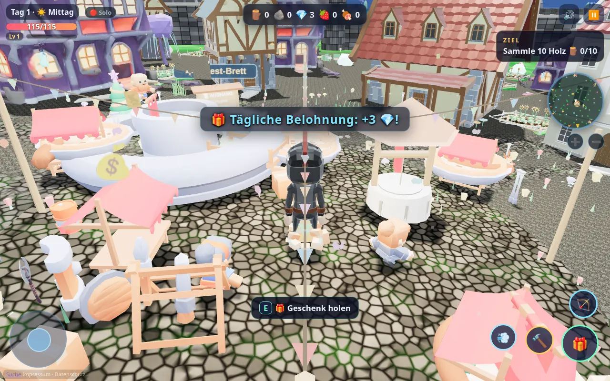
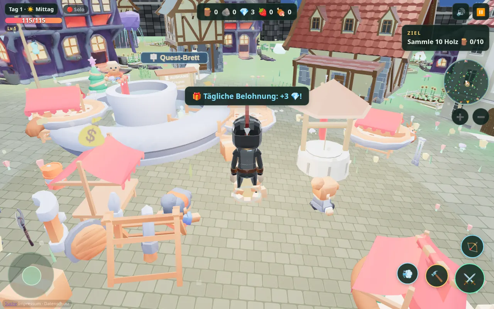
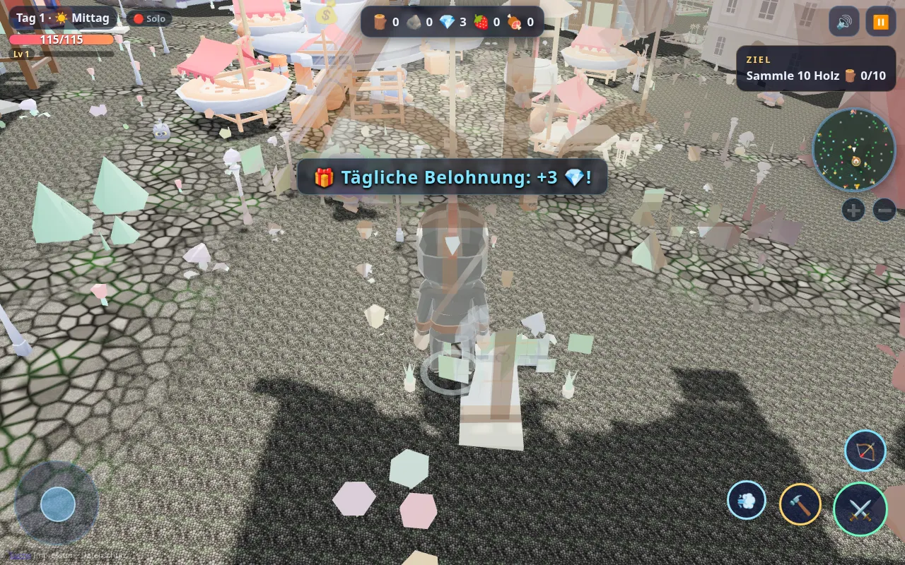
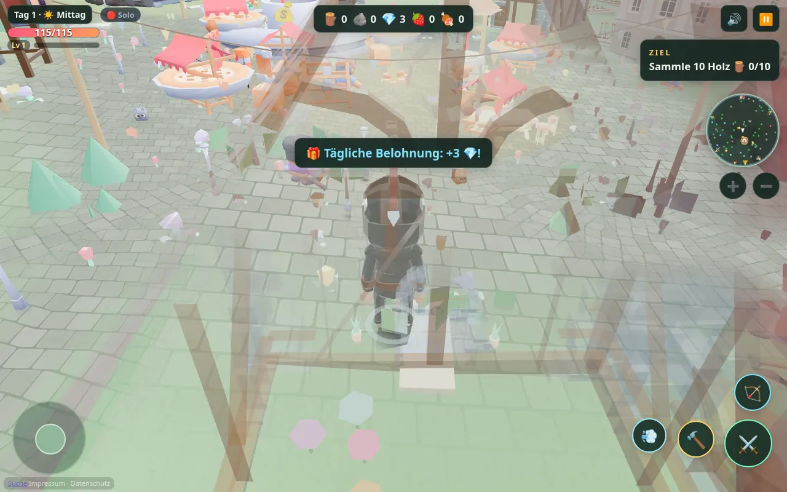
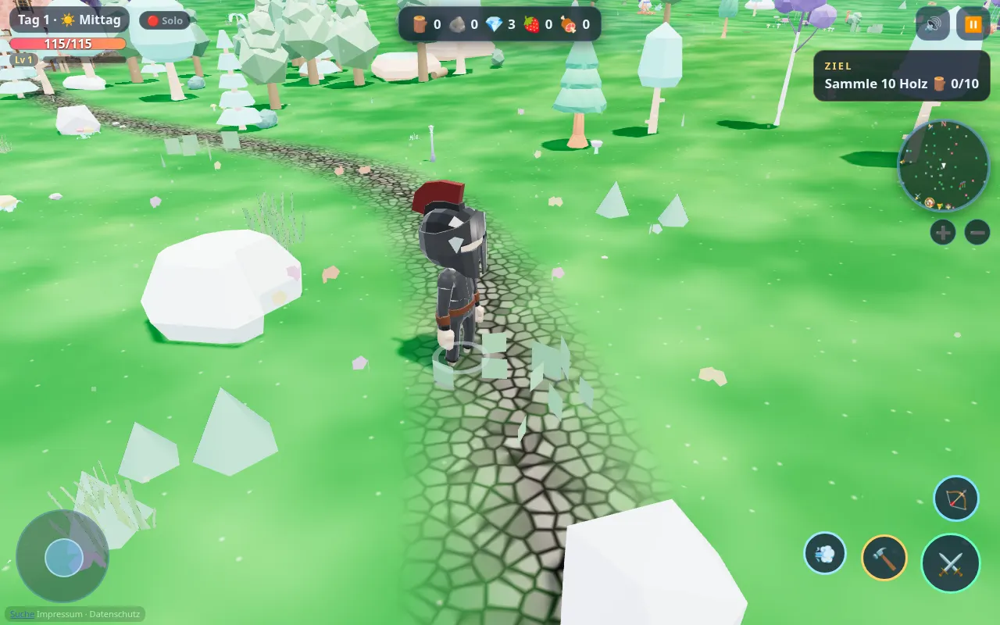
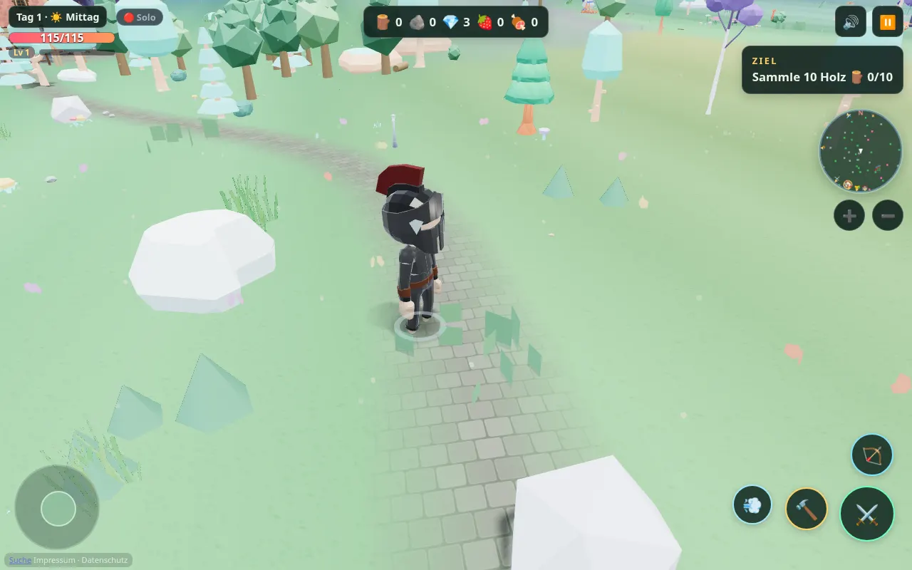
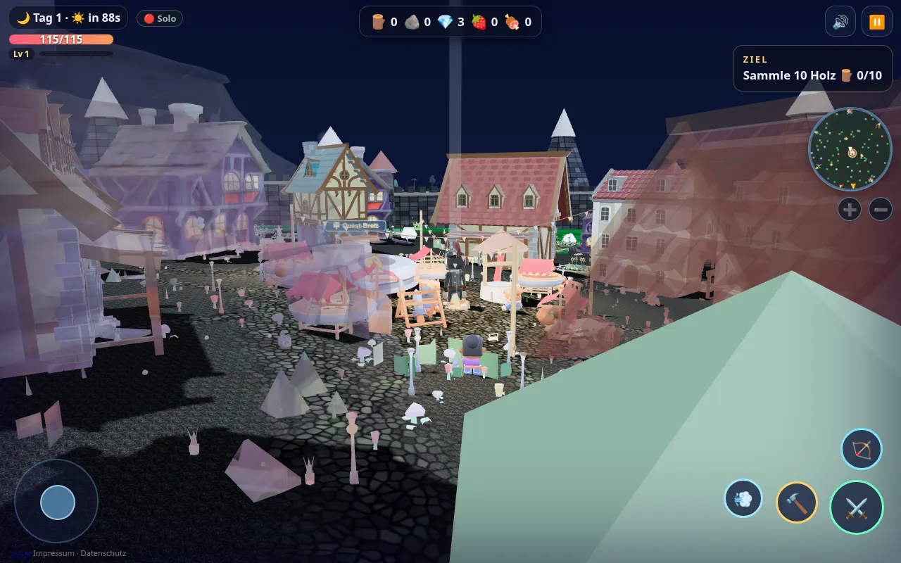
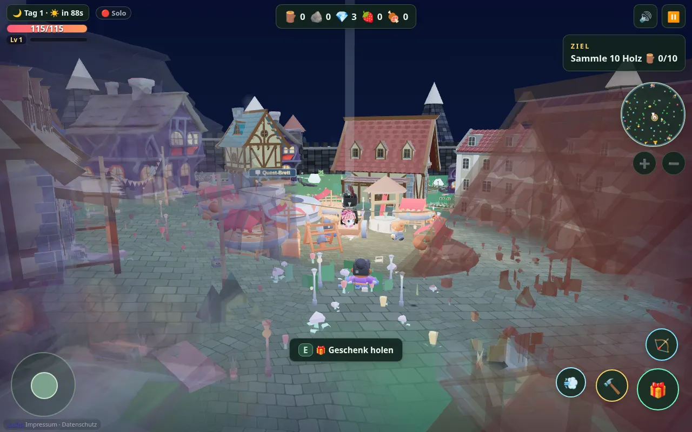

# Neon Wildnis: Grafik, Bedienung und Koop

Stand: 16.11.2026. Folgeauftrag des Besitzers: weitere Spiele verbessern; Spiele-Veröffentlichung bereits erlaubt. Dieser Durchgang betrifft Neon Wildnis. Lebenspfad und parallel bearbeitetes Traumhaus werden nicht erneut umgesetzt.

## Änderungen

- Eigene, dezente Gras-/Pflastertexturen, kleinere Dorfplätze, abgestimmtes Tageslicht und eine grün-goldene Oberfläche. Wimpelketten stehen seitlich vom zentralen Blick. Beete, Zäune und Gießkannen schwingen nicht mehr als ganzer Block.
- Statische Dekorationen mit tatsächlich gleichen Geometrien/Materialwerten werden in räumlichen Instanzen zusammengefasst. Ressourcen, Beute, NPCs, animierte Objekte und ausblendbare Häuser bleiben ausgenommen. Vorhandene große Instanzen werden mit dem unveränderten Lebenspfad-Helfer räumlich geteilt. Konservative r128-Bounds und separate lokale Raytests erhalten Treffer und Sichtbarkeit.
- Vier Lichtplätze auf Touch-Geräten, sechs am Desktop ersetzen eine wechselnde Zahl gleichzeitig gerenderter Punktlichter. Logische Quellen behalten Farbe, Intensität und Sichtbarkeit; entfernte Bauvorschauen werden freigegeben. Ferne Dekorationen werden ausschließlich während des synchronen Zeichenaufrufs ausgeblendet. Ohne echte Schatten gibt es eine gemeinsame, dem Gelände folgende Kontaktfläche.
- Gespeicherte Grafikprofile **Automatisch**, **Sparsam**, **Details**. Automatik reduziert bei dauerhaft langen Frames die Auflösung. Pause, Weltkarte und Station zeichnen die schwere Welt nicht weiter; vorhandene Netz-Ticks bleiben aktiv. Bloom bleibt auf den bestehenden Hardwarepfad beschränkt; Zielgrößen berücksichtigen die tatsächliche Renderauflösung.
- Vier Formate geprüft: 1280×800, 390×844, 360×640, 640×360. Anzeigen, Gesten und Aktionsknöpfe überdecken sich in den geprüften Zuständen nicht. Rezeptlisten sind scrollbar; Gesten liegen unter den Menüs.

## Bestätigte Fehler

**Unterschiedliche Koop-Welten:** Gleicher Seed ergab vorher am Desktop 373 Ressourcen/71 Collider und auf Touch 224/65; auch Dörfer und Stationen unterschieden sich. Gemeinsame Welterzeugung verwendet jetzt dieselbe Dichte, ausschließlich innerhalb der synchronen Generatorphasen. Touch-Steuerung und Renderprofil werden im `finally` zurückgestellt. Ein bereits auf einen Raum wartender Start zählt dazu. Das zusätzliche Save-Feld `worldFull` erhält diese Welt beim späteren Solo-Fortsetzen. Alte Saves ohne das Feld behalten ihr bisheriges Verhalten. Verbundene Online-Läufe überschreiben weiterhin keinen Solo-Save. Die vollständigen Desktop-Arrays vor/nach dem Durchgang sind gleich.

**Veraltete Mitspielersuche:** Schnell-Suche, dann privaten Raum öffnen: Ein später Suchcallback konnte den neuen Raum überschreiben. Suchgeneration, Abbruch und an die aktuelle Session gebundene Callbacks verhindern das; alte Sessions und Einladungs-Timer werden aufgeräumt.

**Vorgemerkte Ausweichrolle:** Shift bei offener Weltkarte setzte zuvor eine Rolle, die erst nach dem Schließen ausgeführt wurde. Karte sperrt Spieltasten und erlaubt Escape; direkte Roll-Aufrufe beachten zusätzlich Pause, Fähigkeitenwahl und Station.

**Nicht erreichbare Rezepte:** Im echten lokalen Koop-Lauf war die erste Baukarte außerhalb des Fensters. Begrenzte, scrollbar angeordnete Listen beheben das. Alle 13 Baurezepte wurden anschließend einzeln auf Erreichbarkeit geprüft.

## GEMESSEN: Prüfungen und Grenzen

| Prüfung | Ergebnis | Beleg |
|---|---|---|
| Originalfunktionen in Node-VM mit DOM-/MP-Doubles | 13 Regressionen und zwei Positivkontrollen grün; Altstand erkennt zwei Fehlergruppen | `belege/bedienung-{vorher,nachher}.json` |
| Three r128: Instanzen, Weltmatrizen, Bounds, Frustum, Raycasts, Unterschiede, Dispose | neun Prüfgruppen grün | `static-instances-qa.cjs` |
| Lichtpool, entfernte Quellen, Tag/Nacht, Culling, Ausnahmen, Kontaktfläche | acht Prüfgruppen grün | `visuals-qa.cjs` |
| Tatsächliche Browser-Weltgeneratoren mit lokalen GLBs | Desktop, Touch und Touch-Solo-Fortsetzung: Ressourcen/Collider/Dörfer/Stationen vollständig gleich; Altstand ungleich | `belege/welt-{vorher,nachher}.json` |
| Zwei Browserseiten über natives lokales WebRTC | Privater Raum per UI, offene Datenkanäle, Bewegung übertragen, Mauer per Baumenü/Enter auf beiden Seiten gleich | `belege/koop-lokal.json` |
| Gerenderter Solo-Start, Pause/Grafik, Karte, vier HUD-Größen, echte Parcours-Station und Rückkehr | 20 Bedingungen grün, keine Script-/CSP-Fehler | `belege/solo-gerendert.json` |
| Gezielte abschließende UI-Prüfung nach Änderung der Gesten-Ebene | 24 Bedingungen grün, einschließlich aller Gesten und aller Baurezepte | `belege/layout-rezepte.json` |
| Vier abschließende gerenderte Ansichten | Start, Dorf, Weg und Nacht ohne Scriptfehler; Details-Profil bei Renderverhältnis 1 und Schatten | `belege/grafik-nachher.json`, Bilder unten |

Die gerenderte Solo-Probe liegt unmittelbar vor der letzten Gesten-Ebenenkorrektur und dem initialen Details-Bloom-Resize. Der gezielte abschließende UI-Lauf prüft die neue Ebene ohne 3D-Zeichnen; der abschließende Bildlauf rendert den finalen Spielstand. Beide Layoutläufe schalten Stufe-4-Aktionsknöpfe und Online-Anzeige als **Fixtures** frei; das ist kein erspielter Fortschritt und kein Verbindungsnachweis.

Weltvergleich und lokaler WebRTC-Test schalten nur den schweren 3D-Zeichenpfad aus. Weltmodelle, Spiellogik, UI und native Datenkanäle laufen. Zum Bauen setzt die Testfixture 20 Holz. `?mp=local` verwendet BroadcastChannel zur lokalen Signalisierung und native RTCPeerConnection ohne externe ICE-Server. Das ist **kein Internet-/PeerJS-/NAT-Test**. Weder ein physisches Handy noch die vollständige Kampagne oder alle Stationen wurden durchgespielt.

### Zeichenlast

Fester Seed 317151129, gleiche Cloud-Software-GPU, sechssekündige rAF-Proben nach Weltaufbau. Vorher: **2.885 Aufrufe, 380.647 Dreiecke, 26 Punktlichter, 0,53 rAF/s**, Median 2.516,5 ms. Nachher: **1.149 Aufrufe, 306.045 Dreiecke, sechs Punktlichter, 1,29 rAF/s**, Median 899,9 ms. Die automatische Qualität wechselte dabei von Renderverhältnis 1 mit Schatten zu 0,65 ohne Schatten: Das ist ein Vergleich der Standardkonfigurationen, kein isolierter Instancing-Benchmark. Auch der neue Stand ruckelt unter Software-Rendering deutlich. Keine flüssige Handy-Leistung behauptet. Rohwerte: `belege/grafik-{vorher,nachher}.json`.

Für die abschließenden Bilder wird **nach** dieser Messung auf Details umgestellt; alle acht Vorher-/Nachher-Bilder haben Renderverhältnis 1 und echte Schatten. Dorf-Teleport kann innerhalb eines Hauses liegen: dessen Durchsichtigkeit ist die bestehende Sichtfreigabe für den Helden.

| Ansicht | Vorher | Nachher |
|---|---|---|
| Start |  |  |
| Dorf |  |  |
| Weg |  |  |
| Nacht |  |  |

Gerenderte Handy-Fixture: [390×844](belege/handy-gerendert.webp).

## Wiederholen

Vom Repo-Root; vorhandenes Playwright und Chromium verwenden. Die Browserläufe wegen Software-GPU **nacheinander** starten. Lokaler Server liest die echten `_headers` und löst Spielrouten auf:

```sh
PORT=8170 node spiele-dev/neon-flug/server.cjs
node spiele-dev/wildnis/static-instances-qa.cjs
node spiele-dev/wildnis/visuals-qa.cjs
node spiele-dev/wildnis/bedienung-qa.cjs /tmp/wildnis-bedienung
node spiele-dev/wildnis/welt-qa.cjs
node spiele-dev/wildnis/koop-qa.cjs
node spiele-dev/wildnis/grafik-qa.cjs
NW_UI_ONLY=1 NW_OUT=/tmp/wildnis-layout node spiele-dev/wildnis/grafik-qa.cjs
node spiele-dev/wildnis/blick-qa.cjs
```

Falls nötig `PLAYWRIGHT_MODULE` auf die installierte Bibliothek und `PLAYWRIGHT_BROWSERS_PATH` auf vorhandene Browser setzen. `NW_BASE` überschreibt die Testadresse, beim Bildlauf heißen die Variablen `BASE` und `OUT`. Für den roten Weltvergleich die ursprüngliche Datei aus Commit `80c73edab` als `NW_HTML` und `NW_EXPECT_MISMATCH=1` verwenden; für die alte Bedienung `LP_HTML` setzen. Original-HTML-SHA256: `6d9fc8a2bfeb10f3c4d3c06b1296a8e09a5c45d3cec4f958aa2e32ac7d860220`.

`bash automation/ci_simulation.sh` wurde versucht und scheitert bereits bei `mktemp` unter dem schreibgeschützten `/home/agent`; keine Rechte-/HOME-Umgehung. Echte PR-CI, Hauptseitenlauf und anschließender HTTPS-Abgleich werden im PR belegt. `https-qa.py` prüft beide Spielrouten sowie vier neue/mitbenutzte Assets jeweils roh/versioniert, insgesamt zehn Anfragen mit normaler TLS-Prüfung. Es erzeugt zuerst mit dem vorhandenen `automation/inject-engine.mjs` die erwartete Build-Ausgabe und vergleicht deren Inline-Skripte exakt einschließlich Reihenfolge/Anzahl, Ladereihenfolge, Styles, exakte CSP, DENY sowie Assetbytes und MIME; bei HTTP429 endet der Lauf. Dieser Quellenabgleich ersetzt keinen öffentlichen Spiel- oder NAT-Test.

```sh
RELEASE_COMMIT=<merge-sha> NW_LIVE_OUT=/tmp/wildnis-live python3 spiele-dev/wildnis/https-qa.py
```

Der erste Produktionsabgleich gegen rohe HTML-Quellen meldete zwei Abweichungen: Der bestehende Seitenbauer ergänzt `fetchpriority="high" decoding="async"` an einem Bildliteral innerhalb des Rezept-JavaScripts. Alle acht Assetprüfungen sowie Header/Ladereihenfolge/Styles bestanden schon dabei. Die tatsächliche Builder-Ausgabe stimmt in allen drei Inline-Skripten exakt mit beiden öffentlichen Seiten überein. Das Werkzeug berücksichtigt jetzt diese erwartete Build-Ausgabe; unveränderte rohe Quelle, geänderter Kartenwert und unerwartetes Zusatzskript werden als Gegenproben abgelehnt. Keine pauschale Entfernung von Attributen aus Produktionscode.

Veröffentlichung bestätigt: [PR3197](https://github.com/allengchour-glitch/aban-news-landing/pull/3197), Merge `d93cc7073`. Sechs relevante CI-Läufe am Head `a1900e6dd` grün. Der erste Hauptseitenlauf wurde durch den parallelen Traumhaus-Merge ersetzt; [Lauf43869233424](https://github.com/allengchour-glitch/aban-news-landing/actions/runs/43869233424) veröffentlicht `49b72565f`, enthält Wildnis unverändert und ist erfolgreich. Vier Einrichtungsschritte übersprungen. Zehn abschließende HTTPS-Prüfungen grün; Rohbelege unter `belege/produktion.json`, `belege/build-abgleich.json` und `belege/veroeffentlichung.json`. Der zunächst rote reine Quelldatei-Abgleich bleibt als `belege/produktion-quelldatei.json` erhalten.
